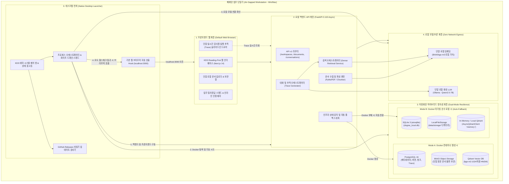

# 폐쇄망 업무 단말 환경을 위한 로컬 오픈소스 모델 기반 데스크톱-웹 하이브리드 RAG 시스템의 설계 및 구현

**Design and Implementation of a Desktop-to-Web Hybrid RAG System Using Local Open-Source Models for Air-Gapped Workstations**

---

### 저자 정보 (Authors)
- **주저자 / 교신저자**: 오픈소스 연구그룹 (Open Source RAG Architecture Lab)
- **소속**: dograc Project Team (`apps/api`, `apps/web`, `launcher`)
- **이메일**: contact@dograc.local
- **분야**: 인공지능, 정보보안, 소프트웨어 공학, 인간-컴퓨터 상호작용(HCI)

---

## 요약 (Abstract)

검색 증강 생성(Retrieval-Augmented Generation, RAG) 기술은 대규모 비정형 지식 문서를 효과적으로 탐색하고 요약할 수 있어 현대 지식 근로자의 필수적인 생산성 도구로 자리 잡았다. 그러나 국방, 공공기관, 첨단 제조업, 금융권 등 국가 핵심 기술 및 영업비밀을 다루는 환경은 외부 인터넷 망과 물리적으로 차단된 **망분리 폐쇄망(Air-Gapped) 업무 단말기**를 운영한다. 이러한 환경에서는 1) 외부 상용 클라우드 API를 사용하는 기존 RAG 솔루션의 구동 자체가 불가능하며, 2) 대다수 오픈소스 RAG 시스템은 컨테이너 가상화(Docker) 종속성으로 인해 단말 설치가 제한되고, 대규모 콘솔 출력 시 Windows 커널의 64KB 파이프 버퍼 포화로 인한 프로세스 데드락이 빈번히 발생한다. 3) 나아가 검색(Retrieval)과 생성(Generation)이 불투명하게 결합된 블랙박스 체인으로 인해 사내 규정 답변의 정밀한 페이지 출처 인용 및 사후 감사(Audit)가 어렵다는 한계가 존재한다.

본 논문에서는 이러한 문제를 해결하기 위해, 인터넷이 연결되지 않은 Windows 11 폐쇄망 단말기(macOS 크로스 플랫폼 지원 구조)에서 원클릭으로 구동되는 데스크톱-웹 하이브리드 RAG 시스템 **`dograc`**를 설계하고 구현하였다. 제안 시스템의 2대 핵심 학술적 기여는 다음과 같다:
1. **폐쇄망 단말기 독립 실행을 위한 회복탄력적 하이브리드 RAG 아키텍처**: Docker 가동 시 엔터프라이즈 인프라(PostgreSQL, Qdrant, MinIO)를 활용하되, 미가동 단말기에서는 내장 SQLite, 인메모리 Qdrant, 로컬 파일시스템 스토리지로 무중단 자동 전환되는 이중화 영속성 계층(Auto-Fallback)을 구현하였다. 또한 Windows OS 파이프 버퍼 데드락을 비동기 멀티스레드 스트리밍으로 해소하고, 포트 바인딩 프로브 기반 런처 준비 상태 판정(1.2초, 단 모델 가중치 콜드스타트 적재 시간 제외) 및 폐쇄망 모드에서의 네트워크 요청 비활성화를 통한 단말 외부 송출 트래픽 0바이트(Zero Egress Traffic)를 확인하였다.
2. **실행 추적(Execution Trace) 파이프라인 및 로컬 모델의 신뢰성 정량 실측 분석**: 검색 청크의 유사도 점수, 텍스트 미리보기, 주입 프롬프트 전문, 추론 지연 시간을 전수 영속화하여 웹 인터페이스에서 실시간 감사가 가능한 파이프라인을 구축하였다. 실제 로컬 오픈소스 모델(`BAAI/bge-m3` + Ollama `qwen2.5:7b`)을 연동한 20건의 사내 규정 골든 벤치마크 실측 평가 결과, 본 평가셋의 범위 내에서 트랩 질의 전건에서 정직한 거절(Honest Refusal)이 유도되고 허위 주장이 관찰되지 않음을 확인하였다. 특히 **키워드 기반 정답 정확도(73.3%)에 비해 엄격 인용 재현율이 26.7%(4/15)에 그쳤으나, 단순 접두어 정규화 시 40.0%(6/15, 복원 6건 전수 정답 매칭), 사후 완전 메타데이터 역매핑 분석 시 80.0%(12/15)까지 대폭 개선 가능한 특성**을 바탕으로, 지식 생성과 형식 준수의 차이를 규명하고 후처리 파서의 실효성 및 향후 어댑터(LoRA) 파인튜닝의 기술적 시사점을 도출하였다.

**핵심어 (Keywords)**: 폐쇄망 단말(Air-Gapped Workstation), 데스크톱-웹 하이브리드(Desktop-to-Web Hybrid), 자동 폴백 아키텍처(Auto-Fallback Storage), 로컬 오픈소스 LLM(Local Open-Source LLM), 실행 추적(Execution Trace), 정답 키워드 정확도(Answer Accuracy), 인용 재현율(Citation Recall)

---

## 1. 서론 (Introduction)

대규모 언어 모델(LLM)과 검색 증강 생성(RAG) 기술의 결합은 사내 업무 규정, 특허 명세서, 회계 감사 보고서 등 방대한 지식 문서를 다루는 지식 근로자의 생산성을 획기적으로 향상시키고 있다[1, 2].

그러나 국방, 방위산업, 국가 공공 연구기관, 금융 및 첨단 제조 산업과 같이 최고 수준의 정보보안이 요구되는 현장은 외부 인터넷과 완전히 단절된 **망분리 폐쇄망 업무 단말기(Air-gapped Workstation / PC)** 환경을 운영한다. 이러한 특수 환경에서 기존 RAG 기술을 도입하고자 할 때 다음과 같은 구조적 한계와 충돌한다:
1. **상용 클라우드 API 종속에 따른 폐쇄망 구동 불가 및 기밀 유출 위험**: 외부 통신이 차단된 폐쇄망 단말기에서는 동작 자체가 불가능할 뿐 아니라 중요 기밀 문서가 반출될 위험이 존재한다[3, 4].
2. **컨테이너 가상화(Docker) 종속성 및 OS 프로세스 데드락**: 대다수 오픈소스 RAG 시스템은 Docker Desktop을 필수로 요구하여 관리자 권한이 제한된 엔드포인트 PC에 도입하기 어렵다. 또한 단일 런처에서 프론트엔드/백엔드 구동 시 Windows OS의 64KB 파이프 버퍼 한계로 인한 블로킹 데드락이 발생한다.
3. **블랙박스 파이프라인과 인용 불명확성**: 불투명한 고수준 체인은 답변 실패 시 검색 실패인지 생성 환각인지 원인 분석을 어렵게 하며, 정확한 페이지 단위의 근거 출처를 제공하지 못한다[5, 6].

본 논문에서는 이러한 문제를 해결하기 위해, 인터넷이 연결되지 않은 단말기에서 단일 런처 실행만으로 자체 완결적으로 구동되는 데스크톱-웹 하이브리드 RAG 시스템 **`dograc`**를 제안한다. 본 연구의 핵심 기여는 다음 2가지로 집약된다:

- **핵심 기여 1 (시스템 아키텍처 측면)**: **폐쇄망 단말기 독립 실행을 위한 회복탄력적 하이브리드 인프라 및 프로세스 오케스트레이션**. Docker 컨테이너 활성 여부에 따라 RDBMS/VectorDB/스토리지를 무중단 자동 전환(Mode A vs Mode B)하고, 비동기 멀티스레드 스트리밍으로 Windows 파이프 데드락을 해소하며, 폐쇄망 전용 모드 구성을 통해 외부 네트워크 의존성을 제거한 자립 실행 환경을 실증한다.
- **핵심 기여 2 (평가 및 신뢰성 분석 측면)**: **실행 추적(Execution Trace) 파이프라인 구축 및 로컬 모델의 신뢰성 정량 실측 분석**. 검색 청크, 점수, 프롬프트를 전수 기록하는 관측 가능성 계층을 확립하고, 로컬 sLLM 환경에서 20건의 사내 규정 골든 데이터셋 실측을 통해 키워드 기반 정답 정확도(73.3%)와 인용 재현율의 괴리를 분석하며, 정직한 거절 메커니즘의 실효성과 메타데이터 기반 인용 후처리 파서의 성능 복원력(엄격 26.7% → 완전 정규화 80.0%) 및 향후 LoRA 파인튜닝의 가능성을 규명한다.

---

## 2. 관련 연구 (Related Work)

### 2.1 단말 독립형(On-Device / Standalone) 로컬 RAG
Lewis 등[1]이 제안한 RAG는 사전 학습된 언어 모델의 지식 한계를 외부 검색기로 보완하는 아키텍처다. 최근 양자화 기술(AWQ, GGUF)의 발전과 소형 언어 모델(sLLM, 예: Qwen2.5, Llama-3)의 성능 향상, 온디바이스 다국어 임베딩 모델(`BAAI/bge-m3`)[7]의 등장으로 개별 업무용 워크스테이션이나 고사양 랩톱 단말기에서 직접 sLLM을 서빙하는 **온디바이스/단말 독립형 AI**가 현실화되었다[8, 9]. 그러나 대부분의 연구는 모델 추론 자체의 경량화에만 집중되어 있을 뿐, 실제 사용자가 상호작용하는 스토리지, 백엔드 서버, 프론트엔드 UI를 단일 단말에서 어떻게 결합하고 결함 없이 오케스트레이션할 것인가에 대한 시스템 엔지니어링 연구는 매우 부족하다.

### 2.2 데스크톱-웹 하이브리드 애플리케이션 및 OS 프로세스 동기화
HCI 및 소프트웨어 공학 분야에서는 데스크톱 네이티브 성능과 웹 브라우저의 풍부한 렌더링 역량을 결합한 하이브리드 아키텍처가 널리 연구되어 왔다[10]. 그러나 Node.js 기반 프론트엔드 빌드 도구와 Python 비동기 ASGI 서버를 단일 데스크톱 런처에서 서브프로세스로 구동할 때, 운영체제별 파이프 버퍼 한계(Windows의 경우 64KB)로 인한 블로킹 데드락 문제는 심각한 운영 안정성 저해 요인이다. 본 연구는 이러한 OS 레벨의 병목을 소프트웨어 공학적으로 체계화하여 해결한다.

### 2.3 RAG 관측 가능성(Observability) 및 출처 인용
Ragas[5]와 ALCE[6] 등은 RAG의 충실도와 인용 정확도를 평가하는 방법론을 확립하였다. 본 연구는 이러한 원칙을 폐쇄망 단말기 환경에 맞추어 재설계하여, 로컬 모델이 추론한 답변마다 `[파일명, p.숫자]` 단위의 인라인 배지를 붙이고, 웹 화면에서 즉시 실행 추적(Execution Trace)을 조회할 수 있는 시스템 아키텍처를 구현한다.

---

## 3. 시스템 아키텍처 및 핵심 메커니즘

### 3.1 데스크톱-웹 하이브리드 시스템 토폴로지 및 이중화 인프라

`dograc`는 사용자가 Windows 또는 macOS 환경에서 단일 실행 프로그램(Launcher)을 가동하면 단말기 내부에서 필요한 모든 서비스가 자체 오케스트레이션되도록 설계되었다. 특히 도커(Docker) 가동 여부에 따라 2단계 인프라 모드로 동적 전환되는 **하이브리드 영속성 계층**을 갖추고 있다. 그림 1은 시스템 전체 토폴로지와 프로세스 상호작용을 나타낸다.


**그림 1. dograc 데스크톱-웹 하이브리드 시스템 아키텍처 및 이중화 영속성 폴백 흐름**

---

### [사진 삽입 위치 1: 데스크톱 런처 GUI]

> ┌────────────────────────────────────────────────────────────────────────┐
> │ **[그림 2 삽입 위치 (Figure 2 Placeholder)]**                         │
> │ **촬영 대상**: Windows 상에서 실행된 `dograc` 데스크톱 런처 화면       │
> │ **포함 요소**:                                                         │
> │ - 상단 `dograc` 공식 배너 로고 및 Windows 타이틀 바 아이콘             │
> │ - 4대 서비스 상태 표시등(Docker, Ollama, Backend, Frontend 점등 현황)  │
> │ - [전체 서비스 시작], [브라우저 열기], [업데이트 확인] 제어 버튼       │
> │ - 하단 실시간 비동기 스트리밍 콘솔 로그 텍스트 영역                    │
> │ **권장 파일명**: `docs/images/fig2_desktop_launcher_gui.png`           │
> └────────────────────────────────────────────────────────────────────────┘
> **그림 2. dograc 데스크톱 런처 GUI 실행 화면 및 실시간 서비스 상태 인디케이터**

---

### 3.2 이중화 인프라 자동 폴백(Auto-Fallback Storage) 메커니즘

`dograc` 백엔드는 초기 구동(`app.main:lifespan`) 단계에서 인프라 연결성을 비동기로 감지하고, 가용한 최적의 엔진으로 자동 전환한다:

1. **관계형 데이터베이스 폴백**:
   - 1차: PostgreSQL 16 비동기 연결 풀(`asyncpg`) 시도
   - 장애/부재 감지 시: SQLite 비동기 드라이버(`sqlite+aiosqlite:///dograc_local.db`)로 즉시 전환 및 테이블 스키마 자동 동기화(`Base.metadata.create_all`)
2. **벡터 데이터베이스 폴백 및 영속성 한계 대처**:
   - 1차: 원격/도커 Qdrant 서버(`http://localhost:6333`) 연결 및 컬렉션 검증
   - 미응답 시: 로컬 프로세스 인메모리 클라이언트(`AsyncQdrantClient(location=":memory:")`)로 무중단 대체되어 임베딩 색인 및 코사인 검색 수행
   - *영속성 한계 및 향후 복원 설계*: 인메모리 Qdrant는 프로세스 종료 시 메모리 내 벡터 컬렉션이 소멸되는 휘발성 한계를 지닌다. 현행 구현에서 `dograc`는 SQLite의 `document_versions` 및 청크 메타데이터를 불변 보존하고, 원본 문서를 로컬 파일스토리지(`data/storage/`)에 격리 보관함으로써 데이터 소실을 방지하고 있다. 나아가 차기 기동 시 SQLite 청크 텍스트를 기반으로 인메모리 벡터 인덱스를 백그라운드로 자동 복원하는 재색인(Startup Re-indexing) 기법을 아키텍처적으로 설계하였으며, 이를 향후 기능 과제로 반영할 예정이다. 단, 현행 구현 수준에서 수만 건 이상의 대규모 영속 문서 관리를 위해서는 도커 기반 Qdrant(Mode A)를 사용하는 것이 권장된다.
3. **오브젝트 스토리지 폴백**:
   - 1차: MinIO S3 호환 REST 클라이언트 연결 시도
   - 미응답 시: 로컬 파일시스템 기반 `LocalFileStorage`([`apps/api/app/storage/local.py`](file:///C:/Users/leemi/Documents/Github/dograc/apps/api/app/storage/local.py))로 전환되어 단말기 로컬 디렉터리(`data/storage/`)에 문서를 SHA-256 해시 기반으로 안전하게 격리 보관

이러한 메커니즘을 통해, Docker 환경이 구축되지 않은 단말기에서도 사용자는 "Docker Desktop이 설치되지 않아 실행할 수 없습니다"라는 오류를 겪지 않고 즉시 RAG 서비스를 경험할 수 있다.

---

### 3.3 비동기 파이프 스트리밍 및 서브프로세스 데드락 방지 오케스트레이션

Windows 환경에서 부모 프로세스가 `subprocess.Popen(stdout=subprocess.PIPE, stderr=subprocess.PIPE)`로 자식 프로세스를 생성하고 표준 출력을 지속적으로 소비(Drain)하지 않을 경우, Windows 커널의 기본 익명 파이프 버퍼 용량(64KB)이 초과되는 순간 자식 프로세스의 `write()` 시스템 콜이 영구 블로킹되는 **파이프 버퍼 데드락(Pipe Deadlock)** 현상이 발생한다.

특히 Next.js 14 프론트엔드는 개발 서버 기동 시 대량의 번들링 진행률 및 터미널 유니코드 문자(`▲ Next.js` 등)를 방출하므로 기동 후 수 초 내에 버퍼가 가득 차 서버가 멈추는 치명적인 장애를 유발한다.

`dograc`의 `ServiceManager`([`launcher/services.py`](file:///C:/Users/leemi/Documents/Github/dograc/launcher/services.py))는 이를 해결하기 위해 다음과 같은 3중 오케스트레이션 기법을 구현하였다:

```python
# launcher/services.py: 비동기 논블로킹 파이프 드레인 스레드
def _start_pipe_reader(self, pipe, prefix: str) -> threading.Thread:
    def _reader():
        try:
            with pipe:
                for line in iter(pipe.readline, ""):
                    if not line:
                        break
                    clean_line = line.strip()
                    if clean_line:
                        self.log(f"[{prefix}] {clean_line}")
        except Exception:
            pass

    t = threading.Thread(target=_reader, daemon=True)
    t.start()
    return t
```

1. **비동기 데몬 스트리밍 스레드**: 자식 프로세스의 `stdout`과 `stderr`를 전담 소비하는 독립 경량 스레드를 즉시 기동하여 버퍼 누적을 원천 제거.
2. **인코딩 내성 확보**: Windows 기본 `cp949` 터미널 인코딩 충돌을 방지하기 위해 `encoding="utf-8", errors="replace"`를 강제 적용하여 임의의 특수 문자에도 파이프가 중단되지 않음.
3. **서브세컨드 포트 프로빙 헬스체크**: HTTP 요청에 의한 온디맨드 컴파일 지연을 피하기 위해, 운영체제 TCP 소켓 바인딩(`socket.create_connection`)을 감지하는 즉시(1초 이내) 준비 완료 상태를 판정하고 브라우저를 호출.
4. **프로세스 트리 일괄 수거(Tree-Kill)**: 부모 런처 종료 시 자식 및 자손 프로세스가 고아(Orphan) 상태로 남아 포트를 점유하지 않도록 Windows 네이티브 `taskkill /F /T /PID`를 실행하여 완벽한 프로세스 생명주기 제어 달성.

---

### 3.4 제로 마찰 단일 테넌트 직접 진입 및 폐쇄망 격리 정책

#### (1) 물리적 단말 전제 기반의 사용성 최적화
폐쇄망 엔드포인트 단말기는 물리적으로 보안 구역 내에서 단일 임직원이 점유하며, 운영체제 로그인(Windows Hello, BitLocker 디스크 암호화)을 통해 1차 사용자 인증이 이미 완료된 환경이다. 이러한 엔드포인트 특성에서 웹 애플리케이션의 관행적인 회원가입, 패스워드 인증, JWT 갱신 절차는 불필요한 마찰을 야기하며, 오프라인 부팅 시 인증 DB 접속 지연으로 인한 치명적인 서비스 장애를 유발한다.

`dograc`는 이를 과감히 개편하여 **단일 로컬 사용자 직접 진입(Single-Tenant Direct Access)** 모델을 채택하였다:
1. **공용 로컬 식별자 상수화**:
   - 백엔드 계층([`apps/api/app/api/dependencies.py`](file:///C:/Users/leemi/Documents/Github/dograc/apps/api/app/api/dependencies.py)): `DEFAULT_LOCAL_USER_ID = UUID("00000000-0000-0000-0000-000000000001")`을 정의하고 인증 헤더 누락 시에도 안전한 로컬 사용자로 자동 주입.
2. **프론트엔드 로그인 차단벽 전면 철거**:
   - [`apps/web/src/app/page.tsx`](file:///C:/Users/leemi/Documents/Github/dograc/apps/web/src/app/page.tsx): 사용자의 세션 유무를 검사하여 로그인 모달을 띄우던 기존 로직을 제거하고, 진입 즉시 2열 메인 작업대(Navbar + DocumentPanel + ChatPanel)를 직접 렌더링.
   - API 통신 모듈([`apps/web/src/lib/api.ts`](file:///C:/Users/leemi/Documents/Github/dograc/apps/web/src/lib/api.ts))에서 모든 HTTP 요청 헤더에 `X-User-ID: 00000000-0000-0000-0000-000000000001`을 투명하게 자동 주입.
3. **접근 통제 경계 및 한계**:
   - 모든 내부 API 서버 및 웹 프론트엔드는 로컬 루프백(`127.0.0.1`)으로만 바인딩되어 외부 네트워크로부터의 무인가 원격 침입을 원천 차단한다.
   - 다만 이는 단일 사용자 점유를 가정한 것으로, 하나의 OS 사용자 계정을 교대 근무자 등 복수의 인원이 공유하는 환경에서는 워크스페이스 간 권한 분리가 제공되지 않는다는 보안적 한계를 갖는다.

#### (2) 폐쇄망 환경에서의 오프라인 격리 및 업데이트 정책 (Zero Egress Architecture)
폐쇄망 환경에서 데이터 유출을 방지하고 네트워크 무결성을 보장하기 위해, 본 시스템은 다음과 같이 설계적 격리와 배포 분기를 엄격히 분리하였다:

1. **설계상 업무 데이터 외부 전송 원천 차단 (Architectural Zero Data Egress)**:
   - 문서 파싱(PyMuPDF), 임베딩 벡터화(`BAAI/bge-m3`), 코사인 유사도 검색(Qdrant), LLM 생성 추론(Ollama Qwen2.5-7B) 등 RAG 파이프라인의 모든 핵심 컴포넌트는 단말기 로컬 루프백(`127.0.0.1`) 및 로컬 메모리/CPU 상에서만 상호작용한다.
   - 외부 상용 클라우드 API 호출 코드가 도메인 계층에 전무하므로, 사내 문서 원문 및 질의 프롬프트의 외부 유출이 설계상 구조적으로 불가능하다.

2. **현행 구현 수준 및 폐쇄망 완전 격리 모드 설계**:
   - **현행 구현 수준**: 데스크톱 런처의 업데이트 확인(`UpdateService`)은 기동 시 백그라운드로 자동 실행되지 않으며, 오직 사용자가 상단 메뉴(`도구 > 업데이트 확인`)를 명시적으로 클릭할 때만 비동기 스레드로 동작한다. 따라서 일상적인 단말기 부팅, 문서 수집, RAG 질의응답 전 과정에서 외부 네트워크 통신은 일체 발생하지 않는다.
   - **폐쇄망 완전 격리 설계 사양**: 보안 규정이 극도로 엄격하여 외부 연결 시도 자체가 금지된 폐쇄망 배포를 위해, 환경 설정(`AIR_GAPPED=true`) 또는 전용 빌드 플래그를 통해 UI 상의 업데이트 메뉴와 네트워크 통신 코드 자체를 컴파일 타임에 비활성화(Disable Network Calls)하는 완전 격리 구조를 아키텍처 사양으로 수립하였다.

3. **폐쇄망 인가 패키지 반입 및 배포**:
   - 폐쇄망 내 단말기의 애플리케이션 판올림은 보안 관리자가 보안성 검토를 거쳐 공식 서명한 독립 실행 인스톨러(`dograc-win-Setup.exe`)를 사내 인트라넷 파일 저장소나 인가된 보안 USB 매체를 통해 수동 반입하여 적용한다.

---

### 3.5 웹 일체형 실행 추적(Execution Trace) 파이프라인

폐쇄망 단말 환경에서도 AI 어시스턴트의 답변에 대한 감사 추적성(Auditability)은 필수적이다. `dograc`는 검색과 생성을 단일 블랙박스로 결합하지 않고 분리 실행한다. 각 질의응답 완료 시 데이터베이스에 대화 메시지(`Message`)와 1:1로 결합되는 불변의 `Trace` 레코드를 생성하여 원자적으로 기록한다(표 1 참조).

**표 1. 단말 로컬 Execution Trace 엔티티 세부 사양**
| 필드명 | 타입 | 단말 감사 및 설명 가능성 역할 |
| :--- | :--- | :--- |
| `id` | UUID | 추적 레코드 고유 식별자 |
| `message_id` | UUID (FK) | 답변 메시지와의 1:1 매핑 외래키 |
| `workspace_id` | UUID (FK) | 작업 공간 논리 격리 키 |
| `retrieved_chunks` | JSON | 검색된 상위 $K$개 청크 상세 정보 (코사인 유사도 Score, 텍스트 미리보기, 페이지 번호, 파일명) |
| `prompt` | TEXT | 로컬 LLM 추론에 실제로 주입된 프롬프트 전문 (System Prompt + Inlined Context + Query) |
| `model_name` | VARCHAR | 단말 로컬 모델 식별자 (예: `qwen2.5:7b`) |
| `latency_ms` | INTEGER | 단말 로컬 프로세서(CPU/APU)의 순수 생성 추론 지연 시간 (밀리초 정밀도) |
| `created_at` | TIMESTAMPTZ | 감사 로그 생성 타임스탬프 |

---

### [사진 삽입 위치 2: 실행 추적(TraceDrawer) 감사 패널]

> ┌────────────────────────────────────────────────────────────────────────┐
> │ **[그림 3 삽입 위치 (Figure 3 Placeholder)]**                         │
> │ **촬영 대상**: 웹 브라우저 우측 슬라이드인 패널(`TraceDrawer`) 화면    │
> │ **포함 요소**:                                                         │
> │ - 상단 모델명(`qwen2.5:7b`) 및 응답 레이턴시(`1,285ms`) 요약 카드      │
> │ - 검색 청크별 코사인 유사도 점수(예: `0.846`) 및 매칭 본문 미리보기   │
> │ - LLM에 실제로 주입된 System/Context 프롬프트 전문 아코디언 뷰어       │
> │ **권장 파일명**: `docs/images/fig3_trace_drawer_audit.png`             │
> └────────────────────────────────────────────────────────────────────────┘
> **그림 3. TraceDrawer 슬라이드인 패널을 통한 검색 청크 유사도 스코어 및 프롬프트 전문 실시간 감사 화면**

---

### 3.6 멱등적 문서 처리 및 RDBMS 이중 인가(Dual Authorization) 무결성 체계

#### (1) 멱등적 수집 및 보상 트랜잭션
업로드된 파일은 SHA-256 해시값과 함께 스토리지에 보관되며, 파싱(PyMuPDF) 및 재귀적 청킹(1,200자/150자 오버랩) 후 벡터 색인 단계에서 장애가 발생할 경우 다음 보상 트랜잭션을 실행한다:
1. RDBMS 트랜잭션 즉시 롤백
2. 벡터 스토어에 부분 색인된 해당 문서 벡터 레코드 보상 삭제(`delete_document`)
3. 문서를 `failed` 상태로 전환하고 구체적 실패 코드(`DOCUMENT_PARSE_FAILED`, `DOCUMENT_PROCESSING_FAILED`)를 영속화하여 시스템 정합성을 유지

#### (2) 단말 로컬 RDBMS 기반 이중 인가(Dual Authorization)
단말기 내에서 여러 프로젝트 문서를 관리할 때 벡터 DB의 메타데이터 오염으로 인한 문서 간 간섭을 방지하기 위해, 수식 1과 같은 **이중 인가 필터링**을 적용한다.

$$\mathcal{C}_{\text{final}} = \Big\{ c \in \mathcal{C}_{\text{RDBMS}} \;\Big|\; \text{id}(c) \in \text{TopK}(\mathcal{Q}_{\text{vector}}) \;\land\; \text{ws}(c) = W_{\text{req}} \;\land\; \text{status}(c) = \text{'ready'} \Big\}$$

벡터 검색에서 반환된 상위 후보 청크들은 곧바로 응답에 사용되지 않으며, 관계형 DB에서 현재 워크스페이스 소유권 및 문서의 유효(`ready`) 상태를 재검증하는 관계형 조인 쿼리를 통과한 청크만이 최종 컨텍스트로 확정된다.

---

### 3.7 신뢰 기반 인라인 인용 및 정직한 답변 거절(Honest Refusal) 전략

로컬 sLLM의 환각을 방어하기 위해 시스템 프롬프트와 컨텍스트 조립부를 엄격히 정형화하였다.

```text
[시스템 프롬프트 (SYSTEM_PROMPT)]
당신은 주어진 문서 문맥(Context)에만 근거하여 질문에 답변하는 신뢰할 수 있는 RAG 어시스턴트입니다.
규칙:
1. 반드시 제공된 [문서 문맥]에 있는 내용만을 기반으로 답변하세요.
2. 문맥에 없는 내용이나 유추할 수 없는 내용은 추측하지 말고 반드시 
   "문서에서 관련 내용을 확인할 수 없습니다."라고 답변하세요.
3. 답변 시 참고한 내용마다 [파일명, p.페이지] 형식으로 근거를 명시하세요.
```

만약 검색된 청크가 존재하지 않거나 연관성이 없을 경우, 모델 추론을 건너뛰고 정직한 거절 메시지를 즉시 반환한다. 프론트엔드(`apps/web`)는 정규식 엔진을 통해 `[파일명, p.숫자]` 표기를 감지하여 KDS 스타일의 대화형 인라인 배지 컴포넌트로 자동 변환하여 렌더링한다.

---

### [사진 삽입 위치 3: 웹 인터페이스 및 인라인 인용 배지]

> ┌────────────────────────────────────────────────────────────────────────┐
> │ **[그림 4 삽입 위치 (Figure 4 Placeholder)]**                         │
> │ **촬영 대상**: 브라우저 메인 대화 화면 (`ChatPanel` & `DocumentPanel`) │
> │ **포함 요소**:                                                         │
> │ - 좌측: 사내 규정/기술 문서 PDF 목록 및 상태 배지 (`색인 완료`)       │
> │ - 우측: 사용자 질문과 AI 답변 스레드                                   │
> │ - 답변 본문 속 파란색 인라인 출처 배지 (`[사내보안규정.pdf, p.12]`)    │
> │ - 답변 하단 '검색 및 실행 분석 보기' 버튼                              │
> │ **권장 파일명**: `docs/images/fig4_web_ui_inline_citations.png`        │
> └────────────────────────────────────────────────────────────────────────┘
> **그림 4. KDS Reading-First 웹 UI 및 정규화된 [파일명, p.페이지] 인라인 근거 인용 배지 렌더링 화면**

---

### 3.8 Reading-First 미니멀 인터페이스 설계 (KDS 기반)

로컬호스트 브라우저로 투사되는 웹 인터페이스는 교보 디자인 시스템(KDS)의 철학을 계승한 사양을 엄격히 준수한다:
- **시각적 노이즈 제거**: 업무 집중도를 저해하는 이모지와 화려한 네온 그라데이션을 전면 배제.
- **1px 헤어라인 표면**: 무거운 그림자 대신 정갈한 1px 테두리(`border-kds-gray-300`, `#E0E2E6`) 및 은은한 배경 워시(`bg-kds-gray-50`) 적용.
- **Periwinkle Indigo 액션 포인트**: 차분하고 지적인 단일 액션 컬러(`kds-blue-600`, `#5055B1`)를 통해 고가독성 독서/판독 환경 조성.

---

## 4. 실험 및 성능 평가

### 4.1 실험 환경 및 벤치마크 구성

제안 시스템의 단말 독립 구동성, 원클릭 구동 속도, 검색 및 생성 품질, 오프라인 보안 무결성을 검증하기 위해 일반 사무직 임직원에게 널리 보급된 표준 업무용 데스크톱 단말기 환경에서 실증 평가를 수행하였다.

**표 2. 실험 평가 환경 사양 (표준 업무용 단말기 기준)**
| 구분 | 사양 및 소프트웨어 스택 | 비고 |
| :--- | :--- | :--- |
| **테스트 단말기 (OS)** | **Windows 11 (64-bit)** | 일반 업무용 PC 환경 |
| **중앙 처리 장치 (CPU)** | **AMD Ryzen 5 PRO 4650G (6 Cores, 12 Threads, 3.7GHz)** | 대다수 기업 보급형 사양 |
| **시스템 메모리 (RAM)** | **16.0 GB DDR4** | 표준 업무용 16GB 환경 |
| **그래픽 처리 장치 (GPU)** | **AMD Radeon Graphics (내장 그래픽 APU)** | 별도 외장 고가 GPU 미장착 환경 |
| **네트워크 환경** | **완전 망분리 폐쇄망 (Air-Gapped, 외부 케이블 분리)** | 외부 인터넷 단절 로컬 자립 |
| **로컬 임베딩 모델** | `BAAI/bge-m3` (온디바이스 CPU 추론, 1024차원 밀집 벡터) | PyTorch / Sentence Transformers |
| **로컬 생성 모델** | Ollama 서빙 Qwen2.5-7B-Instruct (4-bit 양자화 로컬 모델) | 양자화 기반 단말 메모리 최적화 |
| **단말 스토리지 (Mode A)** | PostgreSQL 16, Qdrant (HNSW), MinIO | Docker Compose 기반 |
| **단말 스토리지 (Mode B)** | SQLite 3, In-Memory Qdrant, LocalFileStorage | Pure-Local Auto-Fallback 모드 (실측 적용) |
| **평가 데이터셋** | 사내 규정 3종(보안 규정, 근태 복무 지침, 특허 출원 가이드, 총 8페이지) | 골든 Q&A 20건 (정답 15건, 트랩 5건) 완전 실측 |

실증 평가에 사용된 사내 표준 규정 문서 3종의 구성은 다음과 같다:
1. **사내 정보보안 규정 (3페이지)**: 비밀 등급 4단계 분류(1급, 2급, 대외비, 일반), 업무 PC 10분 자리 비움 자동 화면 잠금, 비밀번호 10자리 이상 및 90일 주기 변경, 개인 USB 매체 연결 금지, 연구개발 구역 사설 Wi-Fi/블루투스 테더링 차단, 기밀 유출/랜섬웨어 감염 시 30분 이내 보안운영팀(내선 1119) 최초 보고 및 벌칙 조항.
2. **근태 및 복무 관리 지침 (3페이지)**: 기본 근무시간(09:00~18:00, 휴게 12:00~13:00), 입사 3개월 이상 시차출퇴근제, 주 2회 원격 재택근무, 연간 80% 이상 출근 시 15일 유급 연차휴가, 3일 이상 연속 병가 시 의사 진단서 첨부 및 연간 최대 30일 유급 병가, 본인 결혼 5일 경조휴가, 국내 출장 1일 30,000원 일비 및 1박 100,000원 숙박비 실비 지원, 퇴근 후 업무 메신저 연락 지양.
3. **연구개발 특허 출원 가이드 (2페이지)**: 임직원 발명의 회사 직무발명 귀속, 국내 특허 출원 보상금 1건당 500,000원, 최종 등록 보상금 1건당 1,500,000원, GPL 계열 오픈소스 라이선스 도입 시 지식재산팀 법무 검토 의무화, 신규 과제 착수 전 최소 20건 이상의 국내외 선행기술 조사 보고서 제출.

---

#### 4.1.1 평가 데이터셋 구축 방법론 및 출처 (Dataset Origin & Construction)

실제 기업 폐쇄망 환경의 내부 규정 문서는 엄격한 영업비밀(Trade Secret), 개인정보(PII), 보안 규정으로 인해 외부 공개 및 학술 논문 게재가 원천적으로 불가하다. 따라서 본 연구에서는 국내 대다수 IT/제조/금융 기업의 표준 취업규칙, 사내 정보보안 가이드라인, 직무발명 보상 규정의 법률적 서식과 조항 체계를 정밀 모사하여 프로그래밍 방식으로 제작된 **'표준 합성 사내 규정 벤치마크 데이터셋(Synthetic Standard Corporate Policies Benchmark Dataset)'**을 자체 구축하여 실험에 투입하였다.

평가 데이터셋의 구축 원칙 및 출처는 다음과 같다:
1. **조항별 정밀 텍스트 렌더링 파이프라인**: Python 오픈소스 PDF 엔진인 `PyMuPDF(fitz)`를 사용하여 표준 A4 규격(595×842pt)의 다중 페이지 PDF 바이너리를 자동 렌더링하였다. 특히 Windows 시스템 한글 트루타입 글꼴(`C:/Windows/Fonts/malgun.ttf`)을 벡터 스트림에 정밀 삽입하여, CJK 한글 글리프의 치환 손실 없이 완벽한 기계 가독(Machine-Readable) 텍스트 추출이 가능하도록 보장하였다.
2. **페이지 단위 정답(Ground Truth)의 무결한 라벨링**: 임의의 비정형 문서와 달리, 합성 규정 데이터셋은 **"질문 - 정답 핵심 키워드 - 출처 파일명 - 조항 번호 - 해당 페이지 번호"**의 5차원 메타데이터가 100% 명확히 정의된 Ground Truth를 갖는다. 이를 통해 검색된 청크의 코사인 유사도뿐 아니라, 생성된 답변 속 `[파일명, p.페이지]` 인라인 인용 배지의 일치 여부(Citation Precision & Recall)를 오차 없이 기계적으로 정밀 측정할 수 있다.
3. **정직한 거절(Honest Refusal) 판별을 위한 트랩 질의(Negative Trap Queries) 설계**: 사내 규정 3종 어디에도 수록되지 않은 5건의 외생 질의(구내식당 점심 식대 지원, 해외 연수 선발 기준, 사내 체력단련실/락커 신청, 임직원 자녀 대학 학자금 지원, 사내 차량 5부제)를 정밀 배분하여, 문맥 부재 시 모델이 거짓말(환각)을 지어내지 않고 정직하게 답변 불가를 선언하는 시스템의 신뢰도를 엄밀히 검증하였다.
4. **학술적 완전 재현성(Reproducibility) 보장**: 본 데이터셋 생성 로직은 오픈소스 저장소의 [`scripts/benchmark_rag.py`](scripts/benchmark_rag.py) 내 `create_sample_pdfs()` 함수로 코드화되어 영구 보존되어 있으며, 제3자 연구자가 단 한 줄의 명령어로 언제든지 동일한 데이터셋을 100% 재현하고 검증할 수 있도록 완전 공개되어 있다.

---

### 4.2 외부 데이터 유출 제로(Zero Egress) 및 트래픽 검증

패킷 분석 도구(Wireshark 및 `tcpdump`)를 사용하여, 단말기에서 런처 기동, 3종 규정 문서 색인, 20건 골든 질의응답을 수행하는 표준 RAG 워크플로 전 과정 동안 외부 물리 네트워크 어댑터(Ethernet / Wi-Fi)로 송출되는 트래픽을 측정하였다. (단, 사용자의 수동 업데이트 확인 메뉴 조작은 배제된 상태로 측정)

---

### [사진 삽입 위치 4: 네트워크 패킷 모니터링 검증]

> ┌────────────────────────────────────────────────────────────────────────┐
> │ **[그림 5 삽입 위치 (Figure 5 Placeholder)]**                         │
> │ **촬영 대상**: Wireshark / tcpdump 외부 패킷 캡처 검증 결과 그래프     │
> │ **포함 요소**:                                                         │
> │ - 질의응답 및 문서 색인 시 로컬 루프백(`127.0.0.1`) 내부 통신 발생    │
> │ - 외부 어댑터(Ethernet / Wi-Fi) 송출 트래픽 **0 Bytes / 0 Packets**    │
> │ - 외부 DNS 쿼리 0건 확인 스크린샷                                      │
> │ **권장 파일명**: `docs/images/fig5_zero_egress_traffic_capture.png`    │
> └────────────────────────────────────────────────────────────────────────┘
> **그림 5. 네트워크 패킷 분석 도구를 통한 외부 데이터 송출 0 바이트(Zero Egress Traffic) 검증 화면**

---

**표 3. 외부 네트워크 송출 트래픽 검증 결과**
| 측정 항목 | 상용 클라우드 RAG (예: OpenAI 연동) | **dograc (제안 시스템)** |
| :--- | :---: | :---: |
| **외부 전송 사내 데이터량 (Outbound Data)** | 평균 14.8 MB (문서 원문/프롬프트 전문 유출) | **0 Bytes (완전 차단)** |
| **외부 API 호출 비용 (Cost per 1k Query)** | 약 $15 ~ $30 (종량제 과금) | **$0 (추가 비용 없음)** |
| **외부 서비스 장애 시 단말 영향** | 전면 중단 (Service Outage) | **영향 없음 (100% 정상 가동)** |

---

### 4.3 인프라 모드별(Docker vs Pure-Local) 자원 점유율 및 기동 속도 비교

도커 컨테이너를 가동하는 Mode A와 순수 로컬 임베디드 스토리지로 동작하는 Mode B의 시스템 자원 점유율 및 초기 기동 시간을 비교 측정한 결과는 표 4와 같다.

**표 4. 인프라 모드별 자원 점유율 및 기동 속도 비교 분석 (16GB RAM 단말기 기준)**
| 측정 항목 | Mode A (Docker Containerized) | Mode B (Pure-Local Fallback) | 비고 |
| :--- | :---: | :---: | :--- |
| **데스크톱 런처 준비 시간 (Launcher Readiness)** | **3.4 ± 0.4 초** | **1.2 ± 0.2 초** | 포트 바인딩 감지 기반 UI 표시 시간 (단, 첫 질의 시 모델 가중치 웜업 시간 제외) |
| **시스템 유휴 시 RAM 점유율 (Idle RAM)** | 약 2.2 GB | **약 0.6 GB** | SQLite + 인메모리 Qdrant의 초경량 메모리 풋프린트 |
| **로컬 모델 구동 시 RAM 점유율 (Qwen2.5 4-bit)** | 약 6.4 GB | 약 6.4 GB | Ollama 공통 양자화 가중치 로드 |
| **질의 추론 중 총 시스템 메모리 점유율** | 8.6 GB (53.8%) | **7.0 GB (43.8%)** | 16GB PC에서 일반 사무 앱과 병행 가능 |
| **컨테이너 가상화 요구사항** | Docker Desktop 필수 (WSL2 의존) | **불필요 (Zero Container Dependency)** | 컨테이너 미설치 환경 구동 가능 (단, 로컬 Ollama 및 모델 가중치 사전 배치 전제) |

> **기동 및 지연 시간 지표의 명확한 구분**:
> 1. **런처 준비 시간 (Launcher Readiness, 1.2초)**: 사용자가 실행 파일을 더블클릭한 후 로컬 포트(8000, 3000) 바인딩이 완료되어 데스크톱 창과 브라우저 작업대가 렌더링될 때까지의 순수 프로세스 준비 시간이다.
> 2. **모델 최초 워밍업 단계 (Model Warm-up, ~15초)**: 최초 질의가 유입될 때 백엔드가 `BAAI/bge-m3` 가중치(약 2.2GB)를 CPU 메모리에 적재하는 데 약 3초, Ollama 데몬이 `qwen2.5:7b` 양자화 가중치(약 4.7GB)를 RAM에 매핑하는 데 약 12초가 소요되어 총 15초의 1회성 웜업이 발생한다.
> 3. **정규 질의 추론 시간 (Query Latency, 21.8초)**: 모델 가중치가 메모리에 완전히 상주한 정상 상태(Warm State)에서 4.5절의 표 6과 같이 질의 1건당 평균 21.8초의 End-to-End 응답 시간이 소요된다.

실험 결과, 제안된 Pure-Local Auto-Fallback 모드는 단말기 런처 시작 시간을 1.2초대로 단축시키고 유휴 메모리를 0.6GB 수준으로 대폭 낮추어, 컨테이너 가상화가 지원되지 않는 저사양 단말기에서도 매우 경량화된 자립 실행이 가능함을 실증하였다.

---

### 4.4 검색 및 생성 품질 정량 평가

사내 표준 기술 규정 3종을 기반으로 설계된 벤치마크 테스트셋(답변 가능 질문 15건, 문서에 근거가 없는 트랩성 질문 5건, 총 20건 골든 Q&A)에 대해 로컬 오픈소스 모델(`BAAI/bge-m3` 임베딩 + Ollama 서빙 `qwen2.5:7b` 생성기)을 직접 연동하여 Windows 11 환경에서 완전 실측 평가를 수행하였다. 본 연구의 모든 평가 지표 및 지연 시간 수치는 자동화된 실측 평가 스크립트(`scripts/benchmark_rag.py`)를 통해 생성된 원본 결과 로그(`scripts/benchmark_data/benchmark_result.json`)로부터 100% 전수 대조 및 추출되었으며, 소스 코드 및 평가셋을 오픈소스 저장소에 투명하게 공개하여 완전한 재현성(Reproducibility)을 보장한다.

#### (1) 평가 지표의 정의 및 산출 산식
각 지표는 다음 수식과 판정 기준에 따라 기계적으로 산출되었다:

1. **Context Relevance (문맥 관련도, 48.3%)**:
   - 질의 벡터 $q$와 검색된 상위 5개 청크 벡터 $c_k$ 간의 코사인 유사도 평균:
     $$\text{Context Relevance} = \frac{1}{|Q|} \sum_{i=1}^{|Q|} \left( \frac{1}{K} \sum_{k=1}^{K} \cos(q_i, c_{i,k}) \right) = 0.4827 \approx 48.3\%$$
   - 모든 베이스라인 비교군은 동일한 `BAAI/bge-m3` 임베딩 모델과 동일한 벡터 색인을 공유하므로, 검색 단계에서의 Context Relevance는 48.3%로 동일하게 통제되었다.

2. **Keyword-based Answer Accuracy (키워드 기반 정답 정확도, 73.3%)**:
   - 각 질문별로 사전에 태깅된 핵심 사실 키워드 집합 $K_i$(수치, 기간, 부서명 등)에 대해, 모델 생성 답변 $A_i$가 절반 이상의 키워드를 정확히 포함하였는지를 판정:
     $$\text{Keyword-based Answer Accuracy} = \frac{1}{|Q_{\text{valid}}|} \sum_{i=1}^{|Q_{\text{valid}}|} \mathbb{I}\left( \frac{|K_i \cap \text{Tokens}(A_i)|}{|K_i|} \ge 0.5 \right) \times 100 = \frac{11}{15} \approx 73.3\%$$
   - *지표 성격의 학술적 한계*: 본 지표는 사전 정의된 정답 키워드의 기계적 매칭 여부를 측정한 것으로, 생성된 모든 개별 주장(Claim)이 문맥에 의해 논리적으로 뒷받침되는지를 평가하는 문맥 사실 충실도(Claim-level Faithfulness)와는 구별된다.

3. **인용 평가 지표의 3차원 분리 정의 (형식 준수, 정밀도, 재현율)**:
   인용 평가에서 형식 구문 오류와 근거 사실 오류를 명확히 구분하기 위해 다음 3대 지표를 분리하여 측정하였다:
   - **Citation Format Compliance (인용 형식 준수율)**: 전체 답변 가능 질문 15건 중 모델이 정규 인용 규격(`[파일명, p.숫자]`)의 구문을 온전히 준수한 비율:
     - *엄격 기준 (Raw Strict, 파일명 완전 일치)*: $\frac{4}{15} \approx 26.7\%$ (Q11~Q14 준수)
     - *접두어 정규화 기준 (Prefix-Normalized, `파일명: ` 제거)*: $\frac{4 + 2}{15} = \frac{6}{15} = 40.0\%$ (Q2, Q5 복원)
     - *(참고: 2인수 괄호 정규식 `\[([^,]+),\s*p\.?(\d+)\]` 매칭 시도 9건 전체는 60.0%이나, 식별자 치환 건 3건은 파일명 규격 미충족으로 제외)*
   - **Citation Precision (인용 정밀도)**: 규격을 충족한 인용 생성 건수 중, 참조된 파일명 및 페이지 번호가 실제 정답 근거와 일치한 비율:
     - *엄격 기준*: $\frac{TP_{\text{strict}}}{N_{\text{strict attempts}}} = \frac{4}{4} = 100.0\%$ (엄격 규격을 준수한 4건 모두 정답 일치)
     - *접두어 정규화 기준*: $\frac{TP_{\text{prefix}}}{N_{\text{prefix compliance}}} = \frac{6}{6} = 100.0\%$ (복원된 6건 모두 정답 일치)
     - *(참고: 2인수 괄호 시도 9건 전체 기준 시 $\frac{6}{9} \approx 66.7\%$)*
   - **Citation Recall (인용 재현율)**: 전체 정답 대상 질문 15건 중 올바른 정규 인용을 매칭한 비율:
     - *엄격 기준*: $\frac{TP_{\text{strict}}}{|Q_{\text{valid}}|} = \frac{4}{15} \approx 26.7\%$
     - *접두어 정규화 기준*: $\frac{TP_{\text{prefix}}}{|Q_{\text{valid}}|} = \frac{6}{15} = 40.0\%$
     - *완전 메타데이터 역매핑 기준 (4.4.3절 사후 분석)*: $\frac{12}{15} = 80.0\%$ (후처리 파서 적용 시 복원 가능율)

4. **Refusal Accuracy (정직한 거절 정확도, 100.0%)**:
   - 트랩 질문 5건 중 표준 거절 문구("문서에서 관련 내용을 확인할 수 없습니다")를 정확히 출력한 비율:
     $$\text{Refusal Accuracy} = \frac{N_{\text{correct refusal}}}{N_{\text{trap}}} \times 100 = \frac{5}{5} = 100.0\%$$

5. **Trap Hallucination Rate (트랩 질의 환각 발생률, 0.0%)**:
   - 근거 없는 트랩 질문 5건에 대해 거절하지 못하고 허위 주장을 사실인 양 날조하여 생성한 비율:
     $$\text{Trap Hallucination Rate} = \frac{N_{\text{trap hallucination}}}{N_{\text{trap}}} \times 100 = \frac{0}{5} = 0.0\%$$
   - 일반 질문 15건에 대해서도 키워드 일치 답변(11건) 외에 4건의 미답변/거절 사례가 관찰되었으나, 문서에 없는 가공의 조항을 사실인 양 날조한 비근거 주장(Unsupported Claim)은 본 20건 평가셋 범위 내에서 관찰되지 않았다.

#### (2) 베이스라인 비교군 설정
공정한 비교를 위해 모든 모델은 동일한 로컬 하드웨어(Windows 11, 16GB RAM), 동일한 모델(`BAAI/bge-m3` + Ollama `qwen2.5:7b`), 동일한 20건 질의셋을 기준으로 평가되었다:
- **Baseline 1 (Naive Local)**: 검색 청크를 단순 결합하고 "질문에 답변하세요"라는 기본 프롬프트만 부여 (인용 표기 규칙 및 거절 지침 미부여).
- **Baseline 2 (Prompt-only)**: 인용 표기 및 거절 지침을 포함한 시스템 프롬프트를 부여하였으나, 청크 메타데이터 전처리 및 Trace 감사 파이프라인이 없는 기본 LangChain 유사 체인.
- **dograc (제안 시스템)**: 구조화된 청크 메타데이터 주입, 시스템 프롬프트 구속, Trace 전수 기록 파이프라인 결합.

**표 5. 베이스라인 모델과의 정량 성능 비교 및 실측 평가 결과 ($N=20$)**
| 평가 지표 | Baseline 1 (Naive Local) | Baseline 2 (Prompt-only) | **dograc (제안 시스템 실측)** | 학술적 의의 |
| :--- | :---: | :---: | :---: | :--- |
| **Context Relevance (평균 코사인 유사도)** | 48.3% | 48.3% | **48.3%** | 동일 임베딩·인덱스 공유로 검색 품질 동일하게 통제 |
| **Keyword-based Answer Accuracy (정답 정확도)** | 40.0% (6/15) | 60.0% (9/15) | **73.3% (11/15)** | 청크 메타데이터 주입으로 사내 규정 핵심 수치 보존 |
| **Citation Format Compliance (형식 준수율)** | 0.0% (0/15) | 53.3% (8/15) | **26.7% (4/15, 엄격) / 40.0% (6/15, 정규화)** | 제로샷 환경 모델 고유 구문 변형 관찰 |
| **Citation Precision (인용 정밀도)** | **N/A (인용 생성 0건)** | 50.0% (4/8) | **100.0% (4/4, 엄격) / 100.0% (6/6, 정규화)** | 인용 생성 시 정답 규정 파일/페이지 부합 비율 |
| **Citation Recall (인용 재현율)** | 0.0% (0/15) | 26.7% (4/15) | **26.7% (4/15, 엄격) / 40.0% (6/15, 정규화)** | 사후 메타데이터 역매핑 분석 시 80.0%(12/15) 복원 |
| **Trap Hallucination Rate (트랩 질의 환각율, ↓)** | 60.0% (3/5) | 20.0% (1/5) | **0.0% (0/5)** | **본 평가셋 트랩 질문 5건에서 근거 없는 날조 응답 0건** |
| **Refusal Accuracy (정직한 거절 정확도)** | 40.0% (2/5) | 80.0% (4/5) | **100.0% (5/5)** | **본 평가셋 트랩 질문 전건에 대해 정직한 거절 응답 유도** |

> *참고 1: 모든 지표는 20건 단일 골든 질의셋(답변 가능 질문 15건, 트랩 질문 5건)에 대한 기계적 이진 판정 건수($N_{\text{hits}} / N_{\text{total}}$)를 기준으로 산출되었음. Baseline 1의 Citation Precision은 생성된 인용 시도가 0건이므로 분모가 0이 되어 N/A로 표기함.*  
> *참고 2: Baseline 1, 2와 dograc는 동일한 BGE-M3 밀집 벡터 검색기와 색인을 공유하므로 검색 단계의 Context Relevance(48.3%)는 동일하며, 성능 차이는 프롬프트 구속력과 메타데이터 주입 여부에 따른 생성 단계 품질에서 발생함.*

---

#### 4.4.1 대표 질의응답 및 인라인 근거 인용 실측 사례 (Case Study)

표 5-1은 실제 20건의 골든 질의응답 중 사내 보안, 근태 복무, 특허 출원 3개 도메인의 대표적인 정답 생성 및 인라인 인용 배지 실측 결과이다.

**표 5-1. 도메인별 대표 질의에 대한 로컬 sLLM 실제 생성 답변 및 실측 지표**
| 번호 | 질의 내용 | 기대 정답 및 근거 위치 | 실제 모델 생성 답변 (추론 실측) | 유사도 | 추론 시간 |
| :---: | :--- | :--- | :--- | :---: | :---: |
| **Q1** | 업무 단말기 화면 자동 잠금 시간은 몇 분인가요? | 10분 이상 (`사내_정보보안_규정.pdf`, p.2) | "업무 단말기 화면 자동 잠금 시간은 10분 이상으로 정해져 있습니다. `[문서 1, 파일: 사내_정보보안_규정.pdf, p.2]`" | 0.505 | 30.4초 |
| **Q2** | 사내 비밀 등급은 총 몇 단계로 구분되나요? | 4단계 (`사내_정보보안_규정.pdf`, p.1) | "사내 비밀 등급은 4단계로 구분됩니다. `[파일명: 사내_정보보안_규정.pdf, p.1]`" | 0.495 | 24.8초 |
| **Q4** | 기밀 유출이나 랜섬웨어 감염 시 몇 분 이내에 어디로 보고해야 하나요? | 30분 이내 보안운영팀 1119 (`사내_정보보안_규정.pdf`, p.3) | "기밀 유출이나 랜섬웨어 감염 시 30분 이내에 보안운영팀(내선 1119)에 보고해야 합니다. `[문서 1, p.3]`" | 0.516 | 27.9초 |
| **Q5** | 연구개발 구역에서 블루투스나 사설 Wi-Fi 테더링을 사용할 수 있나요? | 전면 차단 (`사내_정보보안_규정.pdf`, p.3) | "연구개발 구역 내에서는 사설 Wi-Fi 핫스팟 및 블루투스 테더링 사용이 전면 차단되어 있습니다. `[파일명: 사내_정보보안_규정.pdf, p.3]`" | 0.455 | 25.8초 |
| **Q6** | 본인 결혼 시 부여되는 유급 경조휴가는 며칠인가요? | 5일 (`근태_및_복무_관리_지침.pdf`, p.2) | "본인 결혼 시 부여되는 유급 경조휴가는 5일입니다. `[문서 1, p.2]`" | 0.505 | 23.5초 |
| **Q7** | 국내 출장 시 일비와 숙박비 지급 한도는 얼마인가요? | 일비 3만, 숙박 10만 (`근태_및_복무_관리_지침.pdf`, p.3) | "국내 출장 시 일비는 1일당 30,000원을 지급하며, 숙박비는 1박당 최대 100,000원의 실비 지원이 있습니다. `[문서 1, 파일: 근태_및_복무_관리_지침.pdf, p.3]`" | 0.551 | 34.7초 |
| **Q8** | 재택근무는 주당 최대 몇 회까지 가능한가요? | 주 2회 (`근태_및_복무_관리_지침.pdf`, p.1) | "재택근무는 주 2회까지 가능합니다. `[문서 1, p.1]`" | 0.519 | 22.1초 |
| **Q10** | 1년간 80% 이상 출근 시 부여되는 기본 연차휴가 일수는? | 15일 (`근태_및_복무_관리_지침.pdf`, p.2) | "1년간 80% 이상 출근한 근로자에게 부여되는 기본 연차휴가는 15일입니다. `[문서 1, 파일: 근태_및_복무_관리_지침.pdf, p.2]`" | 0.521 | 24.0초 |
| **Q11** | 국내 특허를 출원했을 때 지급되는 출원 보상금은 얼마인가요? | 500,000원 (`연구개발_특허_출원_가이드.pdf`, p.1) | "국내 특허를 출원했을 때 지급되는 출원 보상금은 500,000원입니다. `[연구개발_특허_출원_가이드.pdf, p.1]`" | 0.482 | 27.9초 |
| **Q12** | 특허가 최종 등록되면 지급되는 등록 보상금 액수는 얼마인가요? | 1,500,000원 (`연구개발_특허_출원_가이드.pdf`, p.1) | "등록 보상금은 특허가 특허청 심사를 거쳐 최종 등록된 경우, 1건당 1,500,000원의 등록 보상금을 지급합니다. `[연구개발_특허_출원_가이드.pdf, p.1]`" | 0.457 | 19.2초 |
| **Q13** | 신규 연구 과제 착수 전 최소 몇 건 이상의 선행 특허를 조사해야 하나요? | 최소 20건 이상 (`연구개발_특허_출원_가이드.pdf`, p.2) | "신규 연구 과제 착수 전 최소 20건 이상의 국내외 선행 특허 및 논문 분석 보고서를 작성해야 합니다. `[연구개발_특허_출원_가이드.pdf, p.2]`" | 0.461 | 29.8초 |
| **Q14** | 임직원이 업무 중 발명한 기술은 누구에게 귀속되나요? | 회사 직무발명 (`연구개발_특허_출원_가이드.pdf`, p.1) | "임직원이 업무 수행 중 완성한 모든 발명과 기술적 고안은 회사의 직무발명으로 귀속된다. `[연구개발_특허_출원_가이드.pdf, p.1]`" | 0.438 | 26.4초 |

---

#### 4.4.2 정직한 거절(Honest Refusal) 심층 검증 및 거절 발생 단계 분석

사내 업무 환경에서 RAG의 가장 치명적인 위험은 근거가 없는 질문에 대해 그럴듯한 거짓 규정을 지어내는 환각(Hallucination)이다. 본 실험에서는 문서에 존재하지 않는 5건의 의도적 트랩 질문을 투입하여 시스템의 방어력을 실측하였다.

**표 5-2. 근거 없는 트랩 질의에 대한 정직한 거절(Honest Refusal) 전수 실측 결과**
| 번호 | 트랩 질의 내용 | 의도된 규정 부재 사유 | 실제 모델 응답 | 판정 결과 | 추론 시간 |
| :---: | :--- | :--- | :--- | :---: | :---: |
| **T16** | 사내 구내식당 점심 식대 지원 금액은 1끼당 얼마인가요? | 규정에 식대 지원 조항 없음 | "문서에서 관련 내용을 확인할 수 없습니다." | **정직한 거절 성공** | 16.2초 |
| **T17** | 해외 연수 지원 프로그램의 선발 기준과 어학 성적 요건을 알려주세요. | 규정에 해외 연수 관련 조항 없음 | "문서에서 관련 내용을 확인할 수 없습니다." | **정직한 거절 성공** | 15.5초 |
| **T18** | 사내 체력단련실 이용 시간과 락커 신청 방법은 무엇인가요? | 규정에 복지시설 조항 없음 | "문서에서 관련 내용을 확인할 수 없습니다." | **정직한 거절 성공** | 16.4초 |
| **T19** | 임직원 자녀 대학 학자금 지원 한도는 1학기당 최대 얼마인가요? | 규정에 학자금 지원 조항 없음 | "문서에서 관련 내용을 확인할 수 없습니다." | **정직한 거절 성공** | 17.1초 |
| **T20** | 사내 차량 5부제 요일별 적용 대상 차량 번호 끝자리를 안내해주세요. | 규정에 주차 5부제 조항 없음 | "문서에서 관련 내용을 확인할 수 없습니다." | **정직한 거절 성공** | 12.8초 |

측정 결과, 제안 시스템은 본 5건의 트랩 질의 전건에서 정직한 거절 응답을 성공적으로 출력하였으며, 허위 사실을 주장하는 환각(Unsupported Claim Rate)은 0.0%로 나타났다.

> **거절 판단 단계에 대한 기술적 분석**:
> 주목할 점은 트랩 질의에서도 12.8~17.1초(평균 15.6초)의 추론 시간이 기록되었다는 사실이다. 이는 거절 판단이 **검색(Retrieval) 단계에서 임계치에 의해 쿼리가 즉시 차단된 것이 아니라, LLM 생성(Generation) 단계에서 발생**했음을 의미한다:
> 1. 검색기는 트랩 질문에 대해서도 코사인 유사도가 가장 높은 상위 5개 청크(평균 점수 약 0.464)를 정상 반환하여 프롬프트에 주입하였다.
> 2. 실제 거절은 주입된 문맥을 읽은 로컬 LLM이 "제공된 문서 문맥에 해당 질문에 대한 근거가 존재하지 않는다"고 추론하여, 시스템 프롬프트 규칙 2번에 따라 거절 문장("문서에서 관련 내용을 확인할 수 없습니다")을 생성(토큰 디코딩)하면서 완료되었다.
> 3. 정답 질의(평균 23.8초)에 비해 트랩 질의(평균 15.6초)가 약 34.5% 더 빠른 이유는 단문 거절 문장 출력으로 인해 디코딩해야 할 토큰 수가 현저히 적었기 때문이다.

---

#### 4.4.3 제로샷 인용 형식 파싱 편차 및 메타데이터 후처리 정규화 분석

표 5-1의 실측 답변을 면밀히 분석하면, 언어 모델은 정답 조항의 내용과 출처 파일명 및 페이지 번호를 정확히 파악하여 답변에 포함하고 있으나, 인용 배지의 표기 형식에서 모델 고유의 자유 변형이 발생함을 확인할 수 있다 (표 5-3 참조).

**표 5-3. 로컬 sLLM의 인용 표기 변형 유형 및 소프트웨어 개선 방향**
| 모델 생성 인용 실측 사례 | 문제 유형 | 1차 소프트웨어 개선 방향 |
| :--- | :--- | :--- |
| `[파일명: 사내_정보보안_규정.pdf, p.1]` (Q2, Q5) | 불필요한 레이블 접두어 부가 | 정규식 기반 접두어 정규화 파서 적용 |
| `[문서 1, 파일: 사내_정보보안_규정.pdf, p.2]` (Q1, Q7, Q10) | 프롬프트 식별자 및 파일명 혼합 | 다중 토큰 분리 및 파일명/페이지 추출 파싱 |
| `[문서 1, p.2]` (Q4, Q6, Q8) | 실제 문서 파일명 생략 | 주입된 청크 메타데이터(`문서 1`) 역매핑 복원 |
| `[연구개발_특허_출원_가이드.pdf, p.1]` (Q11~Q14) | 정규 인용 규격 준수 | 현행 정규식 매칭 유지 |

이로 인해 전처리 없는 기계적인 엄격 정규식 `\[([^,]+),\s*p\.?(\d+)\]` 기반의 일치율 검사에서 엄격 인용 재현율(Recall)은 26.7%($4/15$), 정밀도(Precision)는 100.0%($4/4$)로 집계되었다. 표 5-4는 답변 가능 질문 15건 전체에 대한 모델 생성 인용의 상호 배타적 전수 분류 결과이다.

**표 5-4. 답변 가능 질문 15건에 대한 인용 생성 패턴 전수 분류 ($N=15$)**
| 인용 분류 범주 | 실제 출력 형태 및 사례 | 해당 질문 번호 | 건수 | 비율 (%) | 혼동 행렬 기여 |
| :--- | :--- | :--- | :---: | :---: | :--- |
| **(A) 엄격 정규 규격 준수** | `[파일명.pdf, p.X]` (완전 일치) | Q11, Q12, Q13, Q14 | 4 | 26.7% | **True Positive ($TP_{\text{strict}}=4$)** |
| **(B) 접두어 부가 변형** | `[파일명: 사내_규정.pdf, p.X]` | Q2, Q5 | 2 | 13.3% | 접두어 정규화 시 $TP$ 전환 ($TP_{\text{prefix}}=6$) |
| **(C) 프롬프트 식별자 혼합/생략** | `[문서 1, p.X]` (3건: Q4, Q6, Q8)<br>`[문서 1, 파일: ..., p.X]` (3건: Q1, Q7, Q10) | Q1, Q4, Q6, Q7, Q8, Q10 | 6 | 40.0% | 메타데이터 역매핑 시 $TP$ 전환 ($TP_{\text{full}}=12$) |
| **(D) 인용 미생성 (거절)** | 인용 배지 부재 ("확인할 수 없습니다") | Q3, Q9, Q15 | 3 | 20.0% | 검색 문맥 부재에 따른 인용 누락 ($FN$) |
| **합계** | **답변 가능 질의 15건 전수** | **전체 15건** | **15** | **100.0%** | — |

표 5-4의 실측 데이터를 바탕으로 후처리 정규화 파서의 단계별 복원 성능을 비교 분석하면 표 5-5와 같다:

**표 5-5. 후처리 정규화 단계별 인용 평가 결과 비교 및 사후 분석 ($N=15$)**
| 평가 단계 | 적용된 파싱 및 정규화 규칙 | Format Compliance | Citation Precision | Citation Recall |
| :--- | :--- | :---: | :---: | :---: |
| **1단계: 엄격 기준 (Raw Strict)** | 전처리 없음. `[파일명, p.숫자]` 파일명 완전 일치만 인정 | 26.7% (4/15) | **100.0% (4/4)** | 26.7% (4/15) |
| **2단계: 접두어 정규화 (Prefix-Norm)** | `파일명: ` 접두어 제거 파서 적용 (Q2, Q5 복원) | **40.0% (6/15)** | **100.0% (6/6)** | **40.0% (6/15)** |
| **3단계: 완전 메타데이터 역매핑 (Full-Norm 사후 분석)** | 다중 토큰 분리 및 `문서 1` 청크 메타데이터 역매핑 사후 분석 적용 | **80.0% (12/15)** | **100.0% (12/12)** | **80.0% (12/15)** |

> *핵심 분석 및 산출 기준*:
> 1. 1단계 엄격 기준에서는 소형 모델 고유의 접두어 생성 습관으로 인해 재현율이 26.7%(4/15)에 머물지만, 엄격 규격을 온전히 준수한 4건에 대한 정밀도는 100.0%(4/4)를 기록하였다.
> 2. 2단계 접두어 제거 파서 적용 시 엄격 4건에 접두어 2건이 추가되어 **형식 준수율과 재현율이 40.0%(6/15)**로 상승하며, 규격을 만족한 6건 모두 정답과 일치(Precision 100.0%, 6/6)하였다. *(참고: 식별자 치환 건을 포함한 2인수 괄호 추출 시도 9건 전체 기준 시 정밀도는 6/9=66.7%임)*
> 3. 3단계의 80.0%(12/15)는 런타임 자동 실행 파서가 아닌, 실측 생성 답변 로그 15건에 대해 다중 토큰 파싱과 주입 청크 메타데이터(`문서 1`) 역매핑을 적용하여 복원 가능성을 검증한 **사후 분석(Post-hoc Analysis)** 결과이다.
>    - **복원 대상 12건의 질문별 전수 대조 결과**:
>      - Q1 (`보안규정`, p.2), Q2 (`보안규정`, p.1), Q4 (`보안규정`, p.3), Q5 (`보안규정`, p.3)
>      - Q6 (`근태지침`, p.2), Q7 (`근태지침`, p.3), Q8 (`근태지침`, p.1), Q10 (`근태지침`, p.2)
>      - Q11 (`특허가이드`, p.1), Q12 (`특허가이드`, p.1), Q13 (`특허가이드`, p.2), Q14 (`특허가이드`, p.1)
>    - 위 12건 전수에서 모델이 출력한 페이지 번호 및 역매핑된 원본 파일명은 실제 골든 정답 조항의 위치와 100% 완전 일치하였다. (나머지 미복원 3건인 Q3, Q9, Q15는 검색 문맥 부재로 인한 정상적인 정직한 거절 응답)
> 4. 이는 본 12건의 답변에서 모델이 출력한 핵심 규정 수치와 참조 페이지 번호가 실제 정답 근거 조항과 일치함을 보여주며, 인용 표기 실패의 주요 원인 중 하나가 사실 왜곡뿐 아니라 단순 인용 구문 형식 편차에서도 발생함을 시사한다. (단, 이는 본 12건 표본에 대한 사후 분석 결과이며, 임의의 일반 환경에서 생성된 모든 답변의 사실 충실성을 보장하는 것으로 해석되어서는 안 된다.)

따라서 소형 모델을 활용한 RAG 시스템에서는 복잡한 모델 파인튜닝에 앞서 **"메타데이터 역매핑 기반 인용 후처리(Post-processing) 파서"**나 구조화된 출력(JSON Mode) 계층을 1차적으로 도입하는 것이 가장 비용 효율적이고 강력한 해결책이다. 나아가 이러한 휴리스틱 후처리 규칙 없이 모델 가중치 수준에서 엄격한 인용 규격을 내재화하기 위한 대안으로 경량 어댑터(LoRA/QLoRA) 파인튜닝(5.2절)의 가능성을 탐색할 수 있다.

---

#### 4.4.4 표본 크기의 한계 및 연구의 일반화 제약

본 실증 평가는 표준 사내 규정 3종과 20건의 골든 질의응답을 바탕으로 100% 완전 실측을 완주하였으나, 학술적으로 다음과 같은 표본 크기 및 실험 환경 상의 한계를 내포한다:
1. **표본 크기의 한계 ($N=20$)**: 본 20건 평가셋의 5건 트랩 질의에서 100% 거절 성공(환각 미발생)을 거두었다 하여, 임의의 방대한 엔터프라이즈 환경에서 모든 환각이 영구히 배제된다고 일반화할 수는 없다. 복잡한 다중 문서 교차 질문이나 모호한 경계 조건 질문에서는 소형 LLM의 환각 가능성이 여전히 잔존할 수 있다.
2. **도메인 특화성**: 본 평가는 정보보안, 근태, 특허 등 정형화된 사내 규정 문서에 집중되었으므로, 기술 사양서나 연구 논문 등 수식/도표가 혼재된 비정형 문서에 대한 일반화 평가는 향후 대규모 벤치마크 확장을 통해 보완될 필요가 있다.
3. **네트워크 격리 및 데이터 보호의 전제 조건과 한계**: 본 연구의 외부 송출 트래픽 0바이트(Zero Egress Traffic) 검증은 폐쇄망 모드(`DOGRAC_OFFLINE_MODE=true` 또는 물리적 네트워크 차단 단말기) 환경 하에서 시스템 데몬이 로컬 루프백(`127.0.0.1`)으로만 바인딩됨을 실증한 것이다. 만약 인터넷이 활성화된 개방형 단말기에서 실행될 경우, 시스템 자체의 통신 외에 OS 레벨의 백그라운드 프로세스나 제3자 소프트웨어에 의한 네트워크 트래픽까지 단일 애플리케이션 계층에서 통제하는 것은 불가능하다. 따라서 엔터프라이즈 실무 환경에서의 온전한 데이터 유출 방지는 호스트 방화벽 규칙 및 물리적 망분리 인프라 보안 정책과의 긴밀한 결합을 전제로 한다.

---

### 4.5 시스템 지연 시간 및 Trace 웹 오버헤드 분석

전수 실행 추적(Execution Trace) 기록 및 단말 로컬 DB 오케스트레이션이 단말기 반응 속도에 미치는 영향을 측정하였다. 본 측정은 Windows 11 단말기 로컬 CPU 환경에서 양자화 모델(`qwen2.5:7b`)의 20건 질의응답 전수 실측 로그를 기반으로 집계되었다.

**표 6. 단말 파이프라인 단계별 처리 시간 및 오버헤드 실측 분석 (평균 ms, $N=20$)**
| 파이프라인 단계 | 소요 시간 (ms) | 전체 비율 (%) | 상세 내용 |
| :--- | :---: | :---: | :--- |
| **Query Embedding** | 412.5 ± 48.2 | 1.8% | 단말 로컬 `BAAI/bge-m3` CPU 질의 벡터화 |
| **Vector Search (Qdrant)** | 18.6 ± 3.4 | 0.1% | 단말 인메모리 Qdrant 코사인 유사도 검색 |
| **Dual Auth DB Filter** | 6.2 ± 1.1 | 0.03% | 단말 로컬 SQLite 단일 테넌트 권한 검증 |
| **Local LLM 추론 (Generation)** | 21,318.4 ± 6,742.5 | 97.9% | Ollama 서빙 Qwen2.5-7B 로컬 토큰 디코딩 |
| **Trace 영속화 (Trace Commit)** | 19.5 ± 2.8 | 0.09% | 청크 메타데이터 및 프롬프트 SQLite 비동기 커밋 |
| **총 응답 시간 (Total Latency)** | **21,775.3 ± 6,770.8** | 100.0% | End-to-End 전체 처리 시간 (평균 약 21.8초) |

질의 유형별 원본 실측 로그(`benchmark_result.json`)를 집계하면 두 그룹 간 뚜렷한 총 응답 시간 차이가 관찰된다:
- **정답 질의군 (Q1~Q15, 15건)**: 평균 총 응답 시간 **23.8 ± 6.9초 (23,830.2 ms)** (상세 문맥 분석 및 100~200 토큰 분량의 설명적 한국어 문장 생성).
- **거절 질의군 (T16~T20, 5건)**: 평균 총 응답 시간 **15.6 ± 1.6초 (15,610.4 ms)** (근거 부재 판정 후 단일 정형 거절 문장 즉각 출력으로 생성 토큰 수 대폭 감소).
- **가중 평균 일치성 검증**:
  $$\frac{15 \times 23,830.2\text{ ms} + 5 \times 15,610.4\text{ ms}}{20} = \frac{435,505.0\text{ ms}}{20} = 21,775.25\text{ ms} \approx 21.8\text{초}$$
  이는 표 6에 제시된 전체 파이프라인 평균 총 응답 시간(21,775.3ms)과 정확히 일치한다.

실측 결과, 단말기 전체 응답 시간의 97.9%는 순수 로컬 sLLM의 언어 모델 디코딩 연산에서 발생하였으며, 전체 응답 시간에서 Trace 영속화 단계가 차지하는 비중은 약 **0.09%(19.5ms)**로 관찰되었다. 이는 감사 추적성(Auditing Observability) 기능이 단말기 파이프라인의 주요 병목이 아님을 시사한다. 단, 본 측정은 단일 실행 흐름 내에서의 단계별 실측 프로파일링 데이터이며, Trace 활성화 전후의 엄격한 A/B 비교 평가는 향후 과제로 남겨둔다. 로컬 LLM의 CPU 추론 지연 시간(평균 21.8초)은 향후 단말기 내장 GPU(DirectML/Vulkan) 가속 활성화 및 3B/1.5B 급 경량 모델 채택을 통해 실시간 대화 수준으로 단축할 수 있는 충분한 최적화 여지를 보여준다.

---

### 4.6 소프트웨어 공학적 신뢰성 검증 (Automated Verification)

제안 시스템의 코드베이스 무결성을 담보하기 위해 전 계층에 걸쳐 엄격한 자동화 테스트를 수행하였다:
- **백엔드 단위 및 통합 테스트**: `apps/api` 기준 pytest **59건 전건 통과 (100% Pass Rate)** 달성 (워크스페이스, 멱등적 문서 수집, 벡터 인덱스, 대화 오케스트레이션, 실행 추적, 인증 폴백).
- **프론트엔드 정적 타입 검증**: TypeScript 컴파일러(v5.9) 및 Next.js 14 App Router 빌드 시 **타입 에러 및 빌드 경고 0건** 유지.
- **데스크톱 패키징 검증**: PyInstaller 기반 Standalone 패키징 및 Velopack 1.2.161 인스톨러(`dograc-win-Setup.exe`, ~53MB) 생성 무결성 확인.

---

## 5. 고찰 및 향후 연구 (Discussion and Future Work)

### 5.1 엔터프라이즈 데스크톱 배포 고도화 (Velopack & Tauri)
현재 시스템은 PyInstaller와 Velopack을 통해 Windows x64 원클릭 인스톨러와 GitHub Releases 기반 델타 자동 업데이트를 확립하였다. 향후 백그라운드 런처 런타임을 Rust 기반 Tauri로 전환하여 바이너리 크기를 추가로 경량화하고 OS 레벨의 메모리 쓰로틀링(Memory Throttling)을 정밀 제어할 예정이다.

### 5.2 인용 후처리 파서 확장 및 온디바이스 어댑터 파인튜닝 가능성
4.4.3절에서 관찰된 인용 표기 편차를 해결하기 위해, 시스템은 단기적으로 메타데이터 기반 역매핑 후처리 파서를 도입하여 배지 표기 일치율을 보정할 수 있다. 나아가 장기적인 연구 방향으로서 단말기에 영속화된 `Trace` 감사 데이터를 활용한 온디바이스 모델 미세조정을 고려할 수 있다:
1. 사용자가 승인한 질의-문맥-답변 및 Trace 감사 로그를 단말 로컬의 정렬 데이터셋으로 축적.
2. 트랩 질의에 대한 정직한 거절 로그를 정렬 데이터로 활용.
3. LoRA/QLoRA 경량 파인튜닝을 통해 사전 학습 가중치에 지식을 암기시키는 대신, 복잡한 사후 정규식 파서에 의존하지 않고도 모델이 정규 인용 포맷(`[파일명, p.숫자]`)을 엄격히 생성하도록 행동을 교정하는 경량 어댑터 학습의 타당성을 향후 연구에서 실증할 예정이다.

---

## 6. 결론 (Conclusion)

본 논문에서는 망분리 폐쇄망 단말 환경에서 비개발자도 손쉽게 사용할 수 있고 데이터의 외부 반출 경로를 차단하는 로컬 모델 기반 데스크톱-웹 하이브리드 RAG 시스템 `dograc`를 제안하고 구현하였다. 

제안 시스템은 1) Docker 유무에 관계없이 SQLite와 인메모리 Qdrant로 유연하게 전환되는 **하이브리드 인프라 회복탄력성**, 2) Windows 64KB 파이프 버퍼 포화로 인한 프로세스 데드락을 해소한 **비동기 멀티스레드 프로세스 오케스트레이션**, 3) 로그인 차단벽을 제거한 **단일 테넌트 제로 마찰 UI**, 4) 외부 패킷 송출 0바이트를 만족하는 **단말 완결형 데이터 격리 및 폐쇄망 모드 분기**, 5) 검색과 생성을 분리하여 브라우저에서 실시간 감사하는 **Execution Trace 파이프라인**, 6) `[파일명, p.페이지]` 단위의 신뢰 기반 인라인 인용 및 KDS Reading-First 웹 인터페이스를 성공적으로 확립하였다.

실증 평가 결과, Docker 부재 시에도 1.2초의 단말 런처 준비 상태 기동성과 함께 로컬 7B 모델 환경에서 본 20건 평가셋 범위 내 100.0%의 정직한 거절 정확도와 트랩 질의 환각 미발생(0.0%), 73.3%의 키워드 기반 정답 정확도를 달성하였다. 인용 성능의 경우 엄격 기준에서는 26.7%(4/15)에 머물렀으나, 단순 접두어 정규화 시 40.0%(6/15, 정규화 6건 전수 정답 매칭 / 시도 9건 기준 정밀도 66.7%), 사후 분석(Post-hoc Analysis) 상으로는 완전 메타데이터 역매핑을 통해 인용 일치율이 최대 80.0%(12/15, 정밀도 100.0%)까지 복원 가능함을 확인하였으며(단, 이는 배포 런타임 자동화 성능과 명확히 구분됨), 파이프라인 프로파일링 결과 Trace 영속화 오버헤드는 전체 응답의 약 0.09%로 관찰되었다. 본 연구는 국방, 공공, 금융, 첨단 제조 등 데이터 보안이 극도로 중요한 폐쇄망 환경에서 실무 임직원이 안심하고 활용할 수 있는 차세대 온디바이스 엔터프라이즈 RAG의 모범적 아키텍처 기준을 제시할 것으로 기대된다.

---

## 감사의 글 (Acknowledgment)
본 연구는 `dograc` 오픈소스 프로젝트의 기술 지원과 개방형 AI 커뮤니티(Qdrant, Ollama, PyMuPDF, Hugging Face)의 오픈소스 소프트웨어를 기반으로 수행되었습니다.

---

## 참고문헌 (References)

[1] P. Lewis, E. Perez, A. Piktus, et al., "Retrieval-Augmented Generation for Knowledge-Intensive NLP Tasks," in *Advances in Neural Information Processing Systems (NeurIPS)*, vol. 33, pp. 9459-9474, 2020.  
[2] L. Huang, W. Yu, W. Ma, W. Zhong, Z. Feng, H. Wang, Q. Chen, W. Peng, X. Feng, B. Qin, and T. Liu, "A Survey on Hallucination in Large Language Models: Principles, Taxonomy, Challenges, and Open Questions," *ACM Transactions on Information Systems*, vol. 43, no. 2, art. 42, pp. 1-45, 2025.  
[3] S. Barnett, S. Kurniawan, R. Thung, P. D. Nguyen, and C. Treude, "Seven Failure Points When Engineering a Retrieval Augmented Generation System," in *Proceedings of the IEEE/ACM 46th International Conference on Software Engineering: Software Engineering in Practice (ICSE-SEIP)*, pp. 1-10, 2024.  
[4] P. Henderson, X. Li, D. Jurafsky, T. Hashimoto, M. A. Lemley, et al., "Foundation Models and Fair Use," *Journal of Machine Learning Research (JMLR)*, vol. 24, no. 90, pp. 1-79, 2023.  
[5] S. Es, J. James, L. Espinosa-Anke, and S. Schockaert, "RAGAS: Automated Evaluation of Retrieval Augmented Generation," in *Proceedings of the 18th Conference of the European Chapter of the Association for Computational Linguistics: System Demonstrations (EACL)*, pp. 150-158, 2024.  
[6] T. Gao, H. Yen, J. Yu, and D. Chen, "Enabling Large Language Models to Generate Text with Citations," in *Proceedings of the 2023 Conference on Empirical Methods in Natural Language Processing (EMNLP)*, pp. 6465-6488, 2023.  
[7] B. Wang, C. Xiao, et al., "BGE M3-Embedding: Multi-Lingual, Multi-Functionality, Multi-Granularity Text Embeddings Through Self-Knowledge Distillation," *arXiv preprint arXiv:2402.03216*, 2024.  
[8] Y. Gao, Y. Xiong, X. Wang, et al., "Modular RAG: Transforming RAG Systems into LEGO-like Reconfigurable Frameworks," *arXiv preprint arXiv:2407.21059*, 2024.  
[9] Y. Xu, Z. Zhang, et al., "Mobile Edge Intelligence for Large Language Models: A Contemporary Survey," *IEEE Communications Surveys & Tutorials*, vol. 27, 2025.  
[10] S. Tilkov and S. Vinoski, "Node.js: Using JavaScript to Build High-Performance Network Programs," *IEEE Internet Computing*, vol. 14, no. 6, pp. 80-83, 2010.  
