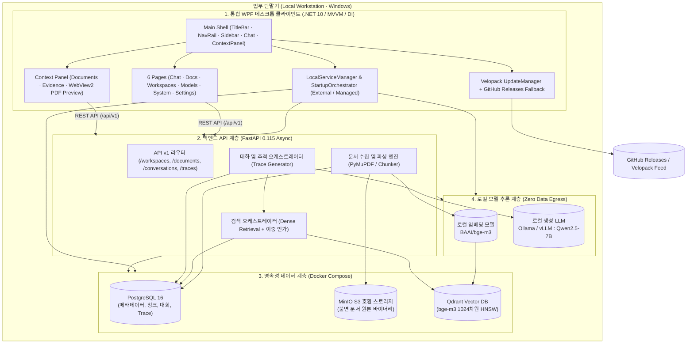

<div align="center">


# dograc

**사내 기밀 정보 보호를 위한 로컬 오픈소스 모델 기반 통합 WPF AI 리서치 워크스페이스**

*단일 WPF 데스크톱 앱 · 100% 로컬 모델 자립 구동 · 투명한 실행 추적(Evidence) · 정밀 인라인 인용 & PDF 미리보기 · Light/Dark KDS UI · Velopack 원클릭 자동 업데이트*

<p align="center">
  
  
  
  
  
  
  
  
</p>

</div>

---

## 1. 개요 (Overview)

**`dograc`**는 사내 규정, 계약서, 특허 명세서, 기술 문서 등 기업 내부의 비정형 지식 문서를 안전하게 탐색·질의응답·검증할 수 있는 **Local AI Research Workspace(통합 WPF 데스크톱 RAG 플랫폼)**입니다.

외부 상용 클라우드 API를 사용하는 기존 RAG 시스템은 사내 핵심 기밀이 외부 서버로 전송되는 심각한 데이터 유출 리스크를 안고 있습니다. `dograc`는 **외부 전송 데이터량 0 바이트(Zero Data Egress)**를 원칙으로 하여, 업무 단말기 내 로컬 오픈소스 모델(Ollama / Qwen2.5, `BAAI/bge-m3`)과 오픈소스 스토리지(PostgreSQL, Qdrant, MinIO)만으로 완전 자립 구동됩니다.

`v0.2.0`부터 기존 Python Tkinter 런처와 Next.js 웹 프론트엔드를 **하나의 네이티브 Windows WPF 애플리케이션(`apps/desktop`)**으로 통합했습니다. 앱 실행 즉시 Main Shell이 열리며, 백그라운드에서 Docker · Ollama · FastAPI 상태를 비동기 점검·자동 기동하고 하나의 창 안에서 문서 관리, 대화형 RAG 질의응답, 근거(Evidence) 감사, PDF 원문 미리보기 및 원클릭 자동 업데이트까지 완결합니다.

---

## 2. 주요 특장점 (Key Features)

### 1) 단일 통합 WPF 워크스페이스 (Main Shell & 6개 독립 페이지)

- **즉시 진입 & 비동기 백그라운드 기동**: 실행 즉시 Main Shell을 표시하고 백그라운드에서 Docker, Ollama, FastAPI 상태를 점검·자동 시작합니다. 최초 환경 구성이 필요한 경우에만 **Setup Wizard**를 띄웁니다.
- **서비스 소유권 구분 (`External` vs `Managed`)**: 이미 외부에서 실행 중인 서비스는 유지하고, `dograc`가 직접 시작한 서비스만 앱 종료 시 안전하게 정리합니다.
- **6-영역 데스크톱 레이아웃**: 커스텀 Windows Title Bar, 좌측 Navigation Rail, 접기·크기조절 가능한 Sidebar(워크스페이스 선택 + 세로 대화 검색/목록), 중앙 AI Chat Workspace, 우측 접이식 Context Panel(`Documents` / `Evidence` / `Preview`), 하단 System Status Bar로 구성됩니다.
- **6개 독립 페이지**: `Chat` · `Documents` · `Workspaces` · `Models` · `System` · `Settings`

### 2) 완전한 온프레미스 & 로컬 모델 자립 구동 (Zero Data Egress)

- 외부 상용 클라우드 API를 호출하지 않아 종량제 과금($0)과 데이터 외부 유출이 없습니다.
- `Models` 페이지에서 로컬 **Ollama (`/api/tags`)** 설치 모델을 자동 감지하여 원클릭으로 전환할 수 있으며, `BAAI/bge-m3` 온디바이스 임베딩을 사용합니다.
- 인터넷 연결이 차단된 폐쇄망 환경에서도 업데이트 확인 등 네트워크 의존 기능이 안전하게 오프라인 처리됩니다.

### 3) 투명한 근거 분석(Evidence) & PDF 원문 미리보기(Preview)

- AI 답변마다 `[파일명, p.숫자]` 형태의 정규화된 **클릭 가능한 인라인 인용 배지**를 렌더링합니다.
- 인용 배지 클릭 시 우측 **Evidence 탭**이 자동으로 열리며, 사용 모델명·응답 지연 시간(`ms`)·코사인 유사도(`%`)·매칭 청크 원문 하이라이트·LLM 주입 프롬프트 전문을 즉시 대조할 수 있습니다.
- **Preview 탭**에서 `WebView2` 기반 인라인 PDF 원문(`#page=N`) 이동, 로컬 파일 연결, 외부 앱 열기 및 TXT/발췌문 Fallback 보기를 지원합니다.
- 사내 문서 문맥에 근거가 없는 질문에는 추측하지 않고 정직하게 답변 불가를 선언합니다.

### 4) Reading-First KDS 디자인 시스템 (Light / Dark / System 테마)

- 교보 디자인 시스템(KDS)의 Reading-First 철학을 WPF `ResourceDictionary` Design Token으로 구현했습니다.
- **Primary Indigo (`#5055B1`)**, **1 DIP 헤어라인 보더**, **4–8 DIP 코너 곡률**, 이모지 배제 및 `Segoe Fluent Icons` 기반의 단정한 UI를 제공합니다.
- 앱 재시작 없이 **System / Light / Dark** 테마를 즉시 전환하며 `%LOCALAPPDATA%\dograc\settings.json`에 영속 저장합니다.

### 5) Velopack 기반 원클릭 자동 업데이트

- 설치 버전(`dograc-win-Setup.exe`) 실행 시 백그라운드에서 GitHub Releases 최신 버전을 자동 확인합니다.
- 새 버전이 감지되면 Title Bar의 **[↓ 업데이트 vX.Y.Z]** 버튼(및 `Settings` 페이지)에서 진행률(`0~100%`)과 함께 원클릭 다운로드·설치·자동 재시작이 가능합니다.

---

## 3. 시스템 아키텍처 (Architecture)



- **계층 분리 (Clean 3-Layer Desktop)**: `Dograc.Core`(도메인 모델·DTO·파서·계약) / `Dograc.Infrastructure`(HTTP API 클라이언트·프로세스/서비스 제어·Ollama·Velopack·JSON 설정) / `Dograc.App`(WPF UI·Design Tokens·ViewModels). WPF 클라이언트는 데이터베이스에 직접 접근하지 않고 REST API로만 통신합니다.
- **이중 인가(Dual Authorization)**: Qdrant 벡터 검색 결과는 PostgreSQL에서 워크스페이스 소유권 및 문서 유효(`ready`) 상태를 관계형 조인으로 재검증하여 데이터 격리를 보장합니다.

---

## 4. 기술 스택 (Tech Stack)

| 영역 | 기술 스택 | 역할 |
| :--- | :--- | :--- |
| **Desktop Client** | **.NET 10**, **WPF**, `CommunityToolkit.Mvvm`, `Microsoft.Extensions.Hosting`, `Microsoft.Web.WebView2` | 통합 Local AI Research Workspace UI, MVVM/DI, KDS Design Tokens, PDF Preview |
| **Packaging & Update** | **Velopack 1.2.161**, PowerShell (`scripts/package_wpf.ps1`), GitHub Actions | Windows x64 원클릭 설치기(`Setup.exe`), Portable ZIP, 델타 자동 업데이트 |
| **Backend API** | **FastAPI 0.115**, SQLAlchemy 2.0 (Async), Alembic, Pydantic v2 | 비동기 고성능 RAG 백엔드 서버 및 실행 Trace 영속화 |
| **Storage** | **PostgreSQL 16**, **Qdrant**, **MinIO (S3 Compatible)** | 워크스페이스 메타데이터, 벡터 인덱스, 문서 원본 불변 보관 |
| **AI / RAG** | **Ollama** (`qwen2.5:7b`), **vLLM**, `BAAI/bge-m3`, PyMuPDF | 모듈형 로컬 임베딩 및 오픈소스 LLM 추론 |
| **Tooling & Test** | **xUnit** (43 passing), **pytest** (62 passing), **Docker Compose**, **uv** | 클라이언트·백엔드 자동화 단위/통합·장애 주입 테스트 및 격리 로컬 인프라 |
| **Legacy (보존 중)** | Python Tkinter (`launcher/`), Next.js 14 (`apps/web/`) | 기능 동등성 최종 검증 완료 전까지 참고·폴백용으로 보존 |

---

## 5. 다운로드 및 설치 가이드 (Download & Installation)

최신 공식 릴리스(`v0.3.0`)는 [GitHub Releases](https://github.com/minwoo1119/dograc/releases/latest)에서 다운로드할 수 있습니다.

### 어떤 파일을 다운로드해야 하나요?

| 배포 파일명 | 파일 크기 | 권장 대상 및 용도 | 주요 특징 |
| :--- | :--- | :--- | :--- |
| [**`dograc-win-Setup.exe`**](https://github.com/minwoo1119/dograc/releases/latest/download/dograc-win-Setup.exe) | 약 73 MB | **일반 사용자 (가장 권장)**<br/>Windows x64 원클릭 설치 프로그램 | • 사용자 폴더에 간편 설치 및 시작 메뉴 바로가기 등록<br/>• **Title Bar / Settings 원클릭 자동 업데이트 및 재시작 지원** |
| [**`dograc-win-Portable.zip`**](https://github.com/minwoo1119/dograc/releases/latest/download/dograc-win-Portable.zip) | 약 66 MB | **무설치 환경 선호 사용자**<br/>Windows x64 Velopack 포터블 패키지 | • 별도 설치 없이 압축 해제 후 즉시 실행 (`dograc.exe`)<br/>• 레지스트리·시스템 폴더 미변경 |
| [**`dograc-wpf-win-x64.zip`**](https://github.com/minwoo1119/dograc/releases/latest/download/dograc-wpf-win-x64.zip) | 약 64 MB | **직접 배포 / 사내 배포용**<br/>Self-Contained WPF 실행 폴더 ZIP | • .NET 런타임 내장 단독 실행 폴더 (`dograc.exe`) |

### 실행 및 자동 업데이트 방법

1. [**`dograc-win-Setup.exe`**](https://github.com/minwoo1119/dograc/releases/latest/download/dograc-win-Setup.exe)를 내려받아 실행하면 설치와 함께 **dograc Desktop**이 즉시 열립니다.
2. 앱이 백그라운드에서 Docker · Ollama · FastAPI 상태를 점검하고 필요한 로컬 서비스를 자동 기동합니다. (초기 구성이 필요하면 Setup Wizard가 안내합니다.)
3. 이후 새 버전이 출시되면 상단 Title Bar에 **[↓ 업데이트 vX.Y.Z]** 버튼이 표시되며, 클릭 한 번으로 다운로드 진행률 표시 후 자동 재시작·업데이트됩니다.

---

## 6. 개발자 빌드 및 실행 (Build & Run)

### 사전 준비 사항

- **Windows 10 / 11 (x64)**
- [.NET 10 SDK](https://dotnet.microsoft.com/download/dotnet/10.0)
- [Docker Desktop](https://www.docker.com/) (PostgreSQL · Qdrant · MinIO 컨테이너용)
- [Python](https://www.python.org/) 3.12+ 및 [uv](https://docs.astral.sh/uv/) (FastAPI 백엔드용)
- 로컬 LLM 구동 시: [Ollama](https://ollama.ai/) 설치 (`ollama run qwen2.5:7b`)

### Step 1. 저장소 클론 및 백엔드 의존성 준비

```powershell
git clone https://github.com/minwoo1119/dograc.git
cd dograc
copy .env.example .env

# 백엔드 가상환경 준비
cd apps\api
uv sync
cd ..\..
```

### Step 2. 통합 WPF 데스크톱 앱 실행

```powershell
dotnet run --project apps/desktop/src/Dograc.App/Dograc.App.csproj
```
> 앱 실행 시 백그라운드에서 Docker Compose · Ollama · FastAPI를 자동 점검 및 기동합니다. 수동으로 백엔드만 따로 띄워 두어도 `External` 서비스로 자동 인식합니다.

### Step 3. 전체 테스트 실행

```powershell
# WPF 클라이언트 빌드 및 단위/통합 테스트 (23 passed)
dotnet build apps/desktop/Dograc.sln --configuration Release
dotnet test apps/desktop/Dograc.sln --configuration Release --no-build

# 백엔드 API 테스트 (59 passed)
cd apps/api
uv run pytest
```

### Step 4. 로컬 Windows 패키징

```powershell
# 포터블 실행 파일 및 ZIP 생성 (artifacts/wpf/dograc-wpf-win-x64.zip)
powershell -ExecutionPolicy Bypass -File scripts/package_wpf.ps1

# Velopack 설치기(Setup.exe) 및 업데이트 피드까지 함께 생성 (vpk CLI 필요)
dotnet tool install -g vpk
powershell -ExecutionPolicy Bypass -File scripts/package_wpf.ps1 -Version 0.2.0 -PackVelopack
```

---

## 7. 사용 가이드 (How to Use)

1. **앱 실행 & 환경 확인**: `dograc.exe`를 실행하면 Title Bar의 `Infra` · `Ollama` · `API` 상태 칩이 실시간으로 갱신되며, 상세 제어와 로그는 `System` 페이지에서 확인할 수 있습니다.
2. **워크스페이스 생성**: 좌측 Sidebar 상단 또는 `Workspaces` 페이지에서 주제·부서별 워크스페이스를 생성합니다.
3. **문서 업로드 및 자동 색인**: 우측 Context Panel의 `Documents` 탭이나 `Documents` 페이지에 PDF/TXT 파일을 드래그앤드롭하면 업로드와 벡터 색인이 자동으로 완료됩니다.
4. **로컬 모델 선택**: `Models` 페이지에서 로컬 Ollama 연결 테스트 후 설치된 모델(`qwen2.5:7b` 등)을 클릭해 활성화합니다.
5. **질의응답 & 근거 검증**: 중앙 `Chat` 페이지에서 질문하고, 답변 내 `[파일명, p.숫자]` 인라인 인용 배지를 클릭해 우측 `Evidence` 탭(유사도·발췌·프롬프트)과 `Preview` 탭(PDF 인용 페이지)으로 바로 대조합니다.

---

## 8. 저장소 구조 (Project Structure)

```text
dograc/
├─ apps/
│  ├─ desktop/                       # [메인] 통합 WPF 데스크톱 솔루션 (.NET 10)
│  │  ├─ Dograc.sln
│  │  ├─ src/
│  │  │  ├─ Dograc.Core/             # 도메인 모델, DTO, CitationParser, 서비스 계약
│  │  │  ├─ Dograc.Infrastructure/   # FastAPI 클라이언트, LocalServiceManager, Ollama, Velopack, Settings
│  │  │  └─ Dograc.App/              # WPF Shell, KDS Design Tokens(Light/Dark), 6 Pages, WebView2 Preview
│  │  └─ tests/
│  │     └─ Dograc.Core.Tests/       # xUnit 단위·E2E 통합 테스트 (23 passed)
│  ├─ api/                           # FastAPI 비동기 백엔드 (http://127.0.0.1:8000)
│  │  ├─ app/api/v1/                 # workspaces, documents, processing, conversations, traces, health
│  │  ├─ app/models/                 # Embedding / Generation 추상화 프로토콜
│  │  └─ tests/                      # pytest 단위 및 통합 테스트 (59 passed)
│  └─ web/                           # [레거시 보존] 기존 Next.js 14 웹 UI 및 DESIGN.md
├─ launcher/                         # [레거시 보존] 기존 Python Tkinter 런처
├─ infra/
│  └─ compose.yaml                   # PostgreSQL 16, Qdrant, MinIO 오케스트레이션
├─ scripts/
│  └─ package_wpf.ps1                # WPF 테스트·Self-Contained 빌드·Velopack 패키징 스크립트
├─ docs/
│  └─ wpf-migration-parity.md        # 기존 Launcher+Web 대비 WPF 기능 동등성 검증 보고서
├─ .github/
│  ├─ ISSUE_TEMPLATE/                # 기능/Phase·버그 이슈 템플릿
│  ├─ PULL_REQUEST_TEMPLATE.md       # PR 리뷰 템플릿
│  └─ workflows/desktop-release.yml  # 태그(v*.*.*) 기반 자동 테스트·Velopack GitHub Release 배포
├─ AGENTS.md                         # 개발자 및 AI 에이전트 지침서
└─ README.md                         # 본 문서
```

---

## 9. 브랜치 전략 및 릴리스 방법 (Branching & Release)

- **브랜치 모델**: `main` (릴리스) ← `dev` (통합 검증) ← `feat/<개발명>` / `docs/<작업명>` (기능별 이슈·PR 단위 작업)
- **자동 릴리스**: `main` 반영 후 `v*.*.*` 태그를 푸시하면 [`.github/workflows/desktop-release.yml`](./.github/workflows/desktop-release.yml)이 자동 실행됩니다.

```powershell
git tag -a v0.2.0 -m "Release v0.2.0 - dograc Unified WPF Desktop"
git push origin v0.2.0
```

GitHub Actions 실행 순서:
1. Python 3.12 + `uv`로 백엔드 테스트(`pytest` 59건) 실행
2. .NET 10 SDK로 WPF 솔루션 빌드·테스트(`xUnit` 23건) 실행
3. `scripts/package_wpf.ps1 -PackVelopack`으로 `dograc-win-Setup.exe`, `dograc-win-Portable.zip`, `releases.win.json`, `*.nupkg`, `dograc-wpf-win-x64.zip` 생성
4. 태그에 대응하는 GitHub Release 생성 및 배포 자산 자동 업로드

---

## 10. 프로젝트 문서 (Documentation)

- [**AGENTS.md**](./AGENTS.md): 아키텍처 원칙, 코딩·커밋 컨벤션, 파인튜닝 및 정량 평가 체계
- [**docs/wpf-migration-parity.md**](./docs/wpf-migration-parity.md): WPF 통합 아키텍처 및 기존 Launcher+Web 기능 동등성 매트릭스
- [**apps/web/DESIGN.md**](./apps/web/DESIGN.md): Reading-First KDS 디자인 시스템 원형 명세서

---

## 11. 라이선스 (License)

본 프로젝트는 [Apache License 2.0](./LICENSE) 하에 자유롭게 이용 및 수정할 수 있습니다. 자세한 내용은 `LICENSE` 파일을 참고하세요.
